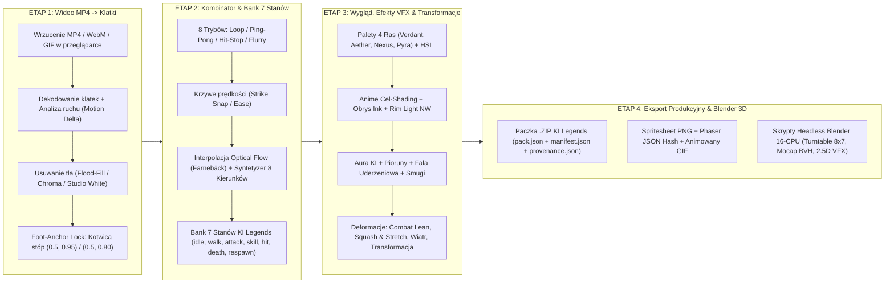

# ⚡ KI Legends — Kombajn do Animacji & Koordynacji (16-CPU Studio v2.0)

> [!IMPORTANT]
> **Gotowa paczka `.zip` oraz pełne środowisko w repozytorium Git:**
> - 📦 Archiwum `.zip` w katalogu głównym repozytorium: [`ki-animation-studio-kombajn.zip`](ki-animation-studio-kombajn.zip)
> - 📂 Katalog roboczy systemu: [`tools/ki-animation-studio/`](tools/ki-animation-studio/)
> - 📖 Szczegółowa instrukcja serwerowa: [`tools/ki-animation-studio/README_INSTRUKCJA_VPS_16CPU.md`](tools/ki-animation-studio/README_INSTRUKCJA_VPS_16CPU.md)

---

## 🏗️ Architektura Systemu (4-Etapowy Potok Produkcyjny Online)



---

## 📦 Zawartość Paczki (`tools/ki-animation-studio/`)

| Moduł / Plik | Rola w systemie |
| :--- | :--- |
| [`config/studio_config.json`](tools/ki-animation-studio/config/studio_config.json) | Główna konfiguracja 16 rdzeni CPU, portu `8090`, 7 kanonicznych stanów animacji, 8 kierunków i kotwic stóp (`(0.5, 0.95)` dla postaci gracza, `(0.5, 0.80)` dla potworów/bossów). |
| [`config/blender_contract.json`](tools/ki-animation-studio/config/blender_contract.json) | Kontrakt kamery ortograficznej Blendera (`60°` elewacji, turntable `0°..315°`), oświetlenia 3-punktowego NW i obrysu Freestyle. |
| [`config/race_palettes.json`](tools/ki-animation-studio/config/race_palettes.json) | Presety kolorystyczne, aury KI i mnożniki transformacji dla ras: **Leśni Wojownicy (`verdant`)**, **Aetherianie (`aether`)**, **Konstrukty (`nexus`)**, **Ogniste Smoki (`pyra`)**. |
| [`backend/video_extractor.py`](tools/ki-animation-studio/backend/video_extractor.py) | Wieloprocesowy ekstraktor klatek MP4 na 16 CPU (`ProcessPoolExecutor`), wycinanie tła z ochroną konturu i automatyczna normalizacja do kotwicy stóp. |
| [`backend/combinator_engine.py`](tools/ki-animation-studio/backend/combinator_engine.py) | Silnik kombinacji klatek (Seamless Loop, Ping-Pong, Hit-Stop z drganiem uderzenia, Combo Flurry, krzywe czasu, interpolacja Optical Flow oraz generator 8 kierunków). |
| [`backend/fx_transform_engine.py`](tools/ki-animation-studio/backend/fx_transform_engine.py) | Silnik modyfikacji wyglądu klatek, efektów specjalnych (Aura KI, wyładowania, fala uderzeniowa, smugi, cień kontaktowy) i transformacji geometrii postaci wokół kotwicy stóp. |
| [`backend/exporter_engine.py`](tools/ki-animation-studio/backend/exporter_engine.py) | Eksporter produkcyjny zgodny z `art/pipeline/stage3-render-contract.json` i `scripts/pack-gpu-frames.ts` (generuje `.webp`, `.png`, `.json`, `.gif`, `provenance.json` z SHA-256 i `.zip`). |
| [`backend/server.py`](tools/ki-animation-studio/backend/server.py) | Serwer API FastAPI + Uvicorn udostępniający panel WWW na `0.0.0.0:8090` oraz punkty końcowe REST na 16 CPU. |
| [`quick_start_zero_deps.py`](tools/ki-animation-studio/quick_start_zero_deps.py) | **Natychmiastowy serwer Zero-Dependencies** (czysty Python 3 stdlib) — odpala panel w 1 sekundę bez czekania na instalację bibliotek `pip`. |
| [`frontend/index.html`](tools/ki-animation-studio/frontend/index.html) & [`frontend/js/studio_app.js`](tools/ki-animation-studio/frontend/js/studio_app.js) | Pełny interfejs online zoptymalizowany pod **telefon (dotyk)** oraz **komputer (PC)** z podglądem 60 FPS, różą 8 kierunków, Onion Skinningiem i wbudowanym pakerem `.zip`. |
| [`blender/blender_headless_turntable.py`](tools/ki-animation-studio/blender/blender_headless_turntable.py) | Skrypt dla Blendera (`blender -b -P ... --threads 16`) renderujący pełną siatkę 8 kierunków × 7 stanów (416 klatek). |
| [`blender/blender_mocap_retarget.py`](tools/ki-animation-studio/blender/blender_mocap_retarget.py) | Skrypt retargetingu animacji Motion Capture `.bvh` (baza CMU) na szkielet postaci KI Legends. |
| [`blender/blender_vfx_card_rig.py`](tools/ki-animation-studio/blender/blender_vfx_card_rig.py) | Projekcja wyciętych klatek MP4 na płaszczyznę 2.5D w Blenderze z oświetleniem 3D i kamerą ortograficzną. |

---

## 🚀 Instrukcja Krok po Kroku: Uruchomienie na Serwerze VPS (16 CPU)

Ponieważ korzystasz z serwera również przez **telefon**, przygotowałem **dwie ścieżki uruchomienia**:
- **Wariant Błyskawiczny (1 komenda, start w 1 sekundę)** — nie wymaga nawet instalacji pakietów `pip`.
- **Wariant Pełny 16-CPU (automatyczny instalator + usługa `systemd` działająca 24/7 w tle)** — uruchamia pełny backend `OpenCV + FastAPI + Pillow` na 16 wątkach.

### KROK 1: Pobranie Kombajnu na serwer VPS

Wklej w terminalu na swoim serwerze (`root@Maffer:~#`) jedną z poniższych opcji:

#### Opcja A — Pobranie prosto z Git (gałąź `pop1`):
```bash
git clone -b pop1 https://github.com/circus574-cpu/pixel-playground-launch.git /opt/ki-repo 2>/dev/null || (cd /opt/ki-repo && git fetch origin && git checkout pop1 && git pull origin pop1)
cd /opt/ki-repo/tools/ki-animation-studio
```

#### Opcja B — Jeśli chcesz rozpakować bezpośrednio z paczki `ki-animation-studio-kombajn.zip`:
```bash
mkdir -p /opt/ki-studio && cd /opt/ki-studio
unzip -o ki-animation-studio-kombajn.zip
cd tools/ki-animation-studio
```

---

### KROK 2: Odblokowanie portu `8090` w zaporze sieciowej (aby wejść z przeglądarki w telefonie / PC)

```bash
ufw allow 8090/tcp 2>/dev/null || true
iptables -I INPUT -p tcp --dport 8090 -j ACCEPT 2>/dev/null || true
```

---

### KROK 3: Uruchomienie serwera (Wybierz Wariant 1 lub Wariant 2)

#### ⚡ WARIANT 1: Natychmiastowy Start w 1 sekundę (Zero zależności, działa od razu)
Wystarczy sam Python 3, który już jest na Twoim Ubuntu:
```bash
python3 quick_start_zero_deps.py --port 8090
```

#### 🔥 WARIANT 2: Pełny Kombajn 16-CPU (FastAPI + OpenCV + FFmpeg + 16 Workerów)
Skrypt sam zainstaluje `ffmpeg`, utworzy środowisko `.venv`, pobierze biblioteki i odpali serwer na 16 rdzeniach:
```bash
chmod +x install_and_run_16cpu.sh
./install_and_run_16cpu.sh
```

---

### KROK 4: Ustawienie działania 24/7 w tle (żeby program nie wyłączał się po zamknięciu terminala w telefonie)

Wklej tę jedną linijkę, aby zarejestrować Kombajn jako usługę systemową `systemd`:
```bash
cp ki-animation-studio.service /etc/systemd/system/ki-animation-studio.service && \
sed -i "s|/opt/ki-animation-studio|$(pwd)|g" /etc/systemd/system/ki-animation-studio.service && \
systemctl daemon-reload && \
systemctl enable --now ki-animation-studio && \
systemctl status ki-animation-studio --no-pager
```

---

### KROK 5: Otwarcie Panelu w Przeglądarce (Telefon / Komputer)

Sprawdź publiczne IP swojego serwera komendą:
```bash
curl -s ifconfig.me ; echo ""
```
Następnie otwórz w przeglądarce na telefonie lub komputerze adres:
```text
http://TWOJE_IP_SERWERA:8090
```

---

## 🎮 Jak korzystać z Kombajnu w Przeglądarce?

1. **ETAP 1 — Wrzucenie MP4 i Rozbicie na Klatki:**
   - Kliknij strefę **„Upuść plik .MP4 / .WEBM / .GIF lub Dotknij tutaj”** (na telefonie otworzy się galeria/pliki) albo kliknij **„Załaduj Demo Wojownika KI (16 klatek)”**, aby od razu przetestować wszystkie suwaki.
   - Wybierz docelową liczbę klatek (`4..64`), rozmiar płótna (`512×512`) oraz tryb wycinania tła (**Auto Flood-Fill + Ochrona Konturu**, **Białe Studio**, **Green Screen**).
   - Kliknij **„ROZBIJ WIDEO NA KLATKI I WYCZYŚĆ TŁO”** — program natychmiast rozbije film na pojedyncze klatki, usunie tło, wyrówna postać do kotwicy stóp (`(0.5, 0.95)` lub `(0.5, 0.80)`) i wyświetli klikalną taśmę klatek wraz z wykresem dynamiki ruchu (*Motion Delta*).

2. **ETAP 2 — Kombinacje Klatek i Bank 7 Stanów:**
   - Klikaj pojedyncze klatki na dolnej taśmie, aby je włączać/wyłączać, albo wpisz własny wzorzec w polu **Własna sekwencja indeksów** (np. `0, 1, 2, 3, 3, 3, 2, 1, 0`).
   - Wybierz jeden z **8 trybów kombinacji**:
     - `Standard (Forward)`
     - `Reverse (Od tyłu)`
     - `Ping-Pong (Tam i z powrotem)`
     - `Seamless Loop (Płynna pętla z domknięciem)`
     - `Hit-Stop Impact (Zamrożenie klatki ciosu + wstrząs bojowy)`
     - `Combo Flurry (Szybka seria wielokrotnych uderzeń)`
     - `Ręczna sekwencja indeksów`
     - `Tylko zaznaczone klatki`
   - Dobierz **Krzywą czasu (Speed Ramping)** (np. *Strike Snap* dla dynamicznego ataku) oraz **Interpolację klatek pośrednich** (`1x`, `2x`, `3x`).
   - Kliknij **„Zapisz aktywną kombinację do Banku Stanu”**, aby przypisać wygenerowany ruch do jednego z 7 stanów (`idle`, `walk`, `attack`, `skill`, `hit`, `death`, `respawn`).

3. **ETAP 3 — Modyfikacja Wyglądu Klatek, Efekty VFX i Transformacje Postaci:**
   - **Kliknij Preset Rasy** (*Verdant*, *Aether*, *Nexus*, *Pyra*) lub dostosuj suwaki **Barwa (Hue)**, **Nasycenie**, **Kontrast**, **Jasność**.
   - **Stylizacja Anime:** ustaw liczbę poziomów cieniowania **Cel-Shading** (`2..8`), grubość **Czarnego Obrysu (Ink Outline)** oraz **Światło Konturowe NW (Rim Light)**.
   - **Efekty Specjalne (VFX):** włącz wielowarstwową **Aurę KI**, **Wyładowania Piorunów KI**, **Falę Uderzeniową pod stopami (Shockwave)**, **Smugi Ruchu (Afterimage Trails)** i **Cień Kontaktowy**.
   - **Transformacje Danych Postaci:** steruj **Pochyleniem Bojowym (Combat Lean)** wokół zakotwiczonych stóp, **Rozciągnięciem (Squash & Stretch)**, **Powiewem Wiatru (włosy/szaty)** oraz **Progresywną Transformacją Formy KI** (puls i wzrost potęgi postaci z klatki na klatkę).

4. **ETAP 4 — Eksport Paczki Produkcyjnej i Blender 3D:**
   - Kliknij **„POBIERZ KOMPLETNĄ PACZKĘ .ZIP (KI LEGENDS CONTRACT)”** — otrzymasz gotowy plik `.zip` z arkuszami spritesheet, klatkami PNG, metadanymi `pack.json`, `manifest.json` (z kotwicami stóp), `provenance.json` (z sumami SHA-256) oraz skryptami Blendera.
   - Możesz również jednym kliknięciem pobrać sam **Spritesheet PNG**, **JSON Hash** lub **Animowany GIF**.
