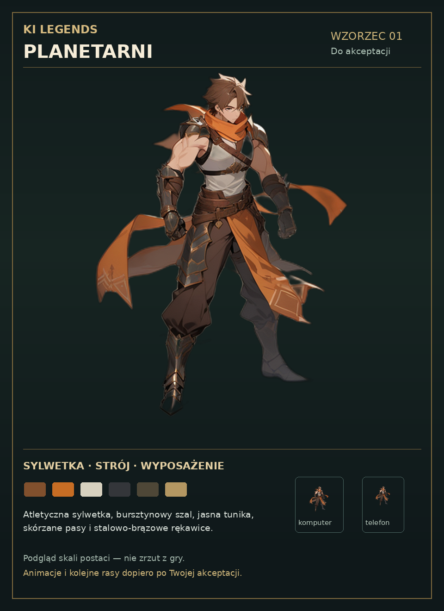

# Ki Legends — osobna akceptacja bohaterów

Obowiązująca kolejność ustalona przez użytkownika: bohaterowie czterech ras, osobna akceptacja każdej rasy, potem animacje, NPC/przeciwnicy, a następnie dopasowanie otoczenia. Nowe plansze dostarczone przez użytkownika są referencją **miast**, nie postaci.

## Planetarni — wzorzec 01: ZAAKCEPTOWANY

To jeden nowo wygenerowany na RTX A6000 wzorzec wyglądu, nie działająca animacja ani screenshot gry. Oparty na oryginalnej tożsamości Planetarnego z dokumentacji/projektu Ki Legends: atletyczny dorosły bohater, brązowe włosy, bursztynowy szal, jasna tunika, skórzane pasy i ciemne bojowe rękawice. Nie wykorzystuje postaci z nowych plansz miast.

- Źródło: `art/production/heroes/planetary/v1/sources/planetary-master.png`, Git LFS.
- Workflow, seed, model i sumy: sąsiedni `planetary-master.json`.
- Model: Animagine XL 3.1, dokładny revision/SHA-256 i licencja w `art/production/city-v1/model-source.json` oraz `MODEL_LICENSE.txt`. Nie pobierano kolejnego modelu dla bohatera.
- Czas tego rzeczywistego zadania ComfyUI: **10.12 s**. Nie jest to pomiar gotowych animacji.
- [Master RGBA 512](qa/hero-planetary-v1/planetary-design-master-512.png), [podgląd 128](qa/hero-planetary-v1/planetary-scale-128.png), [manifest wyników](qa/hero-planetary-v1/review-manifest.json).
- Miniatury 60 i 46 px obrazują rozmiar canvasu 96 jednostek przy zoomie 0.62 i 0.48. To podgląd czytelności, bez deklaracji testu w grze.
- Usunięcie tła i przygotowanie przezroczystego canvasu wykonano lokalnie na CPU. Oryginalny render pozostaje zachowany.
- **Nie zainstalowano bohatera w runtime, nie wygenerowano jego animacji i nie opublikowano zmiany.**

## Dalsze bramki

| Rasa | Status |
| --- | --- |
| Planetarni / Verdantia | Wzorzec zaakceptowany; użytkownik zlecił pełne wykonanie tej rasy |
| Mędrcy / Aetheria | Wstrzymani; najpierw kompletna rasa Planetarnych |
| Androidy / Nexus-9 | Nie rozpoczęto |
| Legendy / Pyra | Nie rozpoczęto |

Po akceptacji Planetarnego najpierw powstaje jego kompletny zestaw; inne rasy pozostają wstrzymane. Animacje są renderowane z jednego modelu i riga. Nie tworzyć ich przez wycinanie ilustracji ani niezależne losowanie kolejnych klatek. Punkt stóp, proporcje i identyfikacja wyposażenia muszą przejść kontrolę na pełnym zestawie ruchów, zanim nastąpi produkcja wszystkich klatek.

## Zabezpieczona wcześniejsza praca i koszt GPU

Dotychczasowe źródła otoczenia, sceny `.blend`, metadane i 32 klatki KI pozostają w Git LFS na `feat/gpu-city-assets-20261020`. Integracja miast została wstrzymana zgodnie ze zmianą priorytetu. Niedokończony mechanizm podglądu zachowano na osobnej gałęzi `wip/city-preview-rollout-20261020`, commit `d20167e` (pełny TypeScript oraz 9/9 testów importu przeszły; nie uruchomiono pełnego E2E ani publikacji tej gałęzi).

Dostępny terminal pozwala generować i zabezpieczać pliki. Odczyt sterującego API RunPod zwrócił **403**, również po ponowieniu z nagłówkiem przeglądarki; samo istnienie zmiennej API nie oznacza działających uprawnień. Nie wykonano Stop/Terminate ani zmiany konfiguracji poda. Po ukończeniu i zabezpieczeniu wzorca GPU nie jest potrzebne do oczekiwania na akceptację; zatrzymanie wynajmu wymaga obecnie panelu użytkownika. Pod nadal działa, dopóki nie zostanie zatrzymany w panelu. Nie kasować woluminu.

## Akceptacja użytkownika

Użytkownik zaakceptował przedstawiony wzorzec słowami „Jest dobrze startuj z tworzeniem tej rasy kompletnie”. Aktywny zakres: kompletny Planetarny, bez rozpoczynania innych ras. Rozpoczęto budowę modelu i riga z licencjonowanej bazy anatomicznej CC0, własnym strojem i geometrią włosów; animacje będą pochodzić z jednego modelu, bez wycinania ilustracji. Późniejszy wpis o akceptacji zastępuje wcześniejszy status oczekiwania w zachowanych metadanych historycznego wzorca.

## Model techniczny — aktualny stan

Zabezpieczono osiem kierunków modelu w `sources/rig-calibration-v2` wraz z edytowalnym `.blend`. Poprawiono sRGB, zamknięte rękawice i buty. To kalibracja, bez instalacji w grze. Skrypt `animate_planetary.py` definiuje siedem rzeczywistych animacji szkieletowych; pierwszy render ruchu wymaga kontroli wizualnej, marginesów i punktu stóp. Nie oznacza to gotowych 416 klatek ani zaliczenia testów w grze.

## Ruch — próba i korekta kamery

Zapisano poza GPU 64 realne klatki próby (`sources/motion-trial-v1`) i źródło `.blend` z siedmioma nazwanymi akcjami. To próba odrzucona do instalacji: boczny kadr przycina włosy, a sylwetka jest zbyt duża. Nie traktować liczby klatek jako odbioru jakości.

Nowy jawny profil `grounded` zachowuje collider 12 i pozycję stóp w świecie; zwiększa zapas canvasu do 128 jednostek, z punktem gruntu `[0.5, 0.75]`. Kamera źródła: 45°, ortho 7.0. Zmniejsza około 430 px sylwetki w poprzednim renderze do około 362 px; na canvasie świata 128 daje około 91 jednostek, blisko zatwierdzonego mastera (około 90). Stały kadr dla wszystkich klatek, bez przycinania/centrowania każdej klatki. Profil `legacy` pozostaje domyślny. Importer odrzuca inne wymiary/pivot i nie dopuszcza nowego profilu dla NPC/przeciwników bez osobnej specyfikacji.

Weryfikacja tego etapu: pełny TypeScript PASS, build PASS, 97/97 testów jednostkowych PASS. Lint po skorygowaniu formatowania plików wygenerowanych wcześniej przez Lovable: 0 błędów, 7 dotychczasowych ostrzeżeń. Pełne E2E w toku; nie ma jeszcze wyniku testów nowego bohatera w grze. Nowy profil jest przygotowany, ale żaden actorBinding nie został podmieniony.
