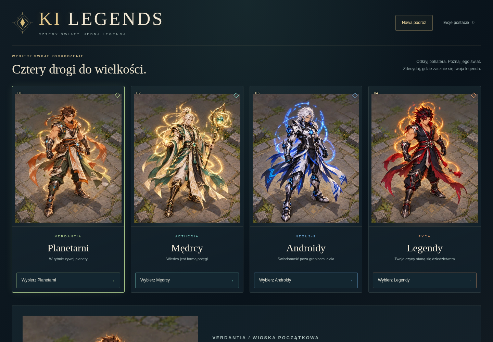
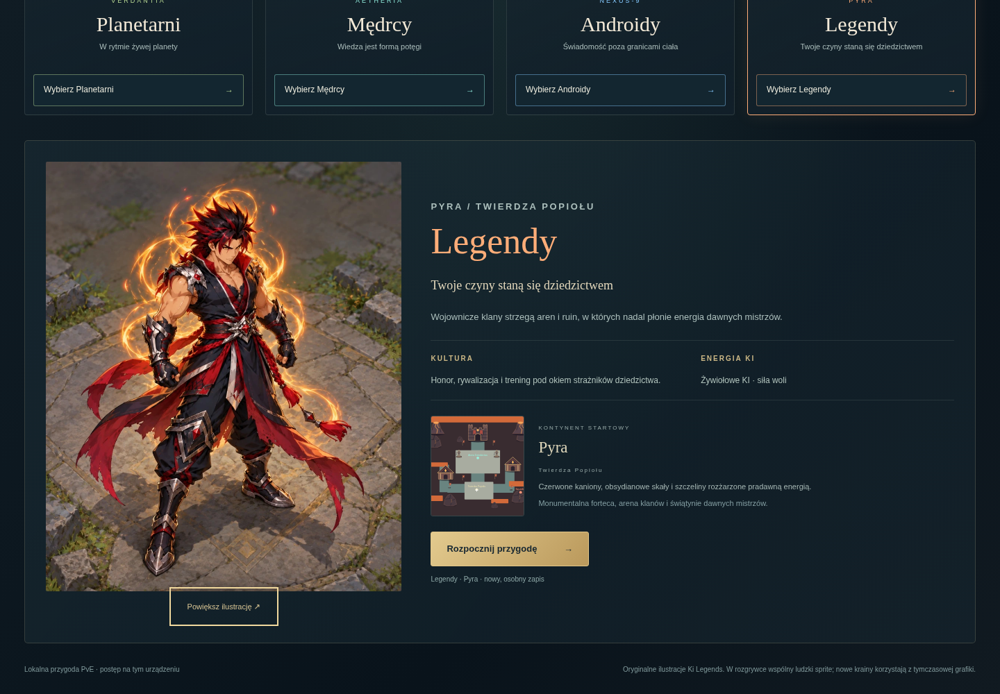
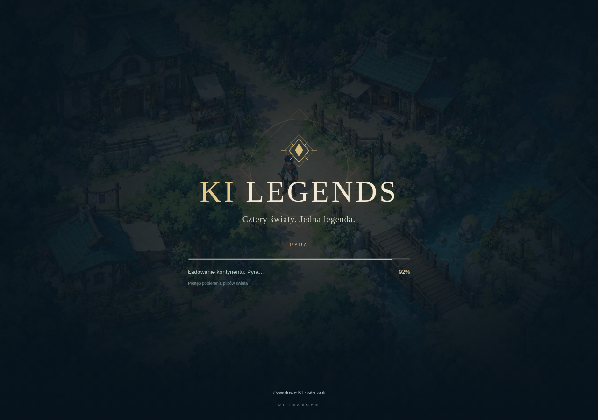
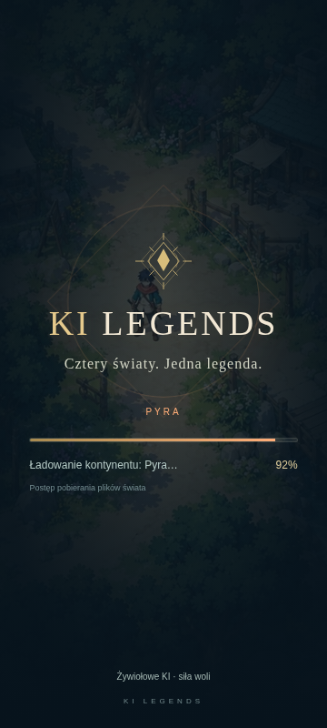
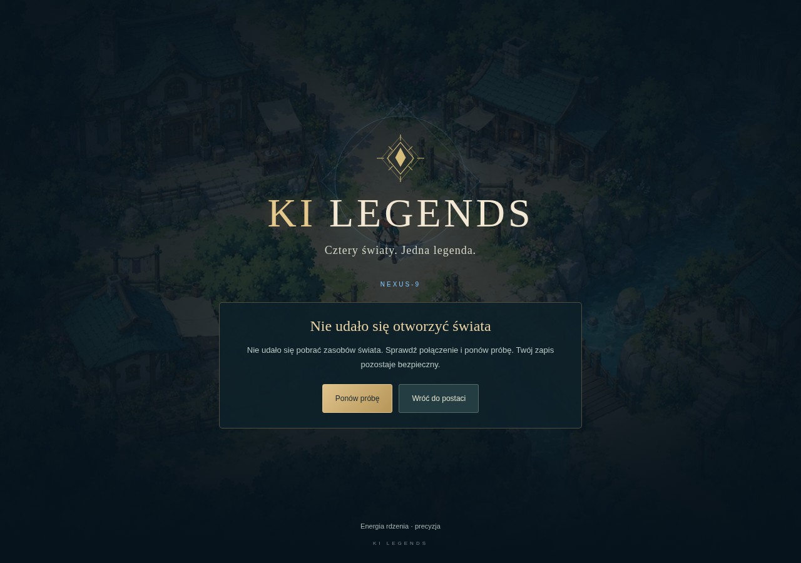

# Ki Legends — QA etapu 3.1: interfejs, oryginalne ilustracje i ładowanie

Data: 2026-10-20. Baza audytu: `cc6f1d9a78e4f7c6a667188be519ab77a02435f0` — rzeczywisty najnowszy `origin/main` przy rozpoczęciu. Gałąź robocza: `feat/stage3-1-ui-and-fixes`. Silnik pozostaje Phaser 4.2.1, React/TypeScript, istniejący Vite/TanStack Start i hosting Lovable.

## Wynik audytu

Przeczytano cały dostarczony PDF (12 stron), obejrzano plansze ras i ilustracje. Wyodrębnienie JPEG z PDF potwierdziło zgodność bajt po bajcie z oryginałami już przechowywanymi w repozytorium. [Link do wskazanego nagrania Tinyfish](https://agent.tinyfish.ai/runs/0f352528-e6b3-42a3-afdc-bfd6cf24ddd1) zwrócił stronę z komunikatem `not found`/`NEXT_HTTP_ERROR`; nie uzyskano nagrania. Poniższe ustalenia wynikają z własnej analizy kodu i testów, a zgłoszenia z promptu traktowano jako hipotezy.

| Zgłoszenie / znaleziony problem | Potwierdzenie i przyczyna                                                                                                                                                                                                                                                                                  | Działanie                                                                                                                                                                                                                                             |
| ------------------------------- | ---------------------------------------------------------------------------------------------------------------------------------------------------------------------------------------------------------------------------------------------------------------------------------------------------------- | ----------------------------------------------------------------------------------------------------------------------------------------------------------------------------------------------------------------------------------------------------- |
| „Twierdza Popiołu — Verdantia”  | Nie odtworzono takiej utrwalonej kombinacji. `WORLDS.pyra` poprawnie przypisuje Twierdzę do Pyry; HUD używa jednego obiektu świata. Potwierdzono osobny problem inicjalizacji: `initialView()` zawsze tworzył Planetarnych/Verdantię przed pierwszym raportem sesji, a HUD montował się podczas ładowania. | Stan początkowy kopiuje wybraną postać. HUD pojawia się dopiero po przygotowaniu i pierwszym renderze świata. Testy sprawdzają pochodzenie podczas inicjalizacji oraz nazwy każdego świata. Nie zmieniano poprawnego mapowania ani migracji w ciemno. |
| Nawigacja Airy i Kaeny          | Lokalne cele są różne i poprawne. Aira prowadzi na rynek, Kaena na Arenę Dziedzictwa.                                                                                                                                                                                                                      | Zachowano lokalne zadania. Testy sprawdzają ukryty przycisk przed przyjęciem, właściwy cel po przyjęciu, rzeczywiste dojście, stan `ready`, powrót, nagrodę, XP i odświeżenie.                                                                        |
| HP/KI                           | Nie potwierdzono nakładania liczb. Są to dwa osobne paski. Wykryto drobną niespójność zaokrągleń: wartość dostępności używała `round`, tekst HP `ceil`, a KI `floor`.                                                                                                                                      | Ujednolicono wartości dostępności z widocznym tekstem. Testy geometrii i różnych wartości opisano poniżej.                                                                                                                                            |
| Przycięte sylwetki              | Potwierdzone. Karty stosowały `object-fit: cover`, a treść nakładała się na obraz.                                                                                                                                                                                                                         | `contain`, pełne kadry bez podpisów, osobna strefa tekstu, powiększenie oryginalnej ilustracji.                                                                                                                                                       |
| Brak rzeczywistego loadera      | Potwierdzone. Poprzednia nakładka informowała tylko o braku `state.ready`, nie prezentowała postępu ani ponawiania.                                                                                                                                                                                        | Nowy ekran podłączony do loadera Phaser, błędów i pierwszego renderu.                                                                                                                                                                                 |
| Zapis / kontynenty              | Architektura v3 i sloty istnieją; nie znaleziono podstaw do zmiany formatu.                                                                                                                                                                                                                                | Zachowano klucze, UUID, kopię starszego zapisu i walidację pochodzenia. Porównywanie ras nie zapisuje postaci; tworzy ją dopiero „Rozpocznij przygodę”.                                                                                               |

Podczas rozwoju nowego powiększenia wykryto też rozciąganie kontenera przez wymiary naturalne obrazu. Ustalono wysokość względem viewportu i wiersz `minmax(0, 1fr)`; test kontroluje faktyczne granice obrazu, nie tylko obecność elementu.

## Nowy wybór ras i marka

Ciemne granatowe tło, złote detale i wspólny znak SVG/napis `KI LEGENDS`. Cztery karty na komputerze, pełne postacie, kontynent, opis i przycisk. Wybór otwiera szczegóły: kultura, energia KI, kontynent, architektura i istniejąca minimapa regionu. Osobny przycisk rozpoczyna nowy zapis.

Na telefonach do 700 px działa natywna karuzela z przyciąganiem kart, przyciskami poprzednia/następna, czterema wskaźnikami oraz obsługą strzałek klawiatury. Powiększenie ilustracji ma nazwany dialog, zamknięcie Escape, powrót fokusu i całe ciało mieszczące się w ekranie. Duże przyciski pozostają poza sylwetką. Animacje respektują `prefers-reduced-motion`.

| Rasa       | Kontynent | Lokalny przewodnik | Cel eksploracji   |
| ---------- | --------- | ------------------ | ----------------- |
| Planetarni | Verdantia | Aira               | Rynek             |
| Mędrcy     | Aetheria  | Sora               | Źródło Pamięci    |
| Androidy   | Nexus-9   | LYRA-7             | Rdzeń Świadomości |
| Legendy    | Pyra      | Kaena              | Arena Dziedzictwa |

W HUD użyto wspólnego kompaktowego znaku marki. Nazwy nadal pochodzą z rejestru `WORLDS`, a pochodzenie z wybranego zapisu. Nie dodano osobnego, konkurencyjnego słownika nazw.

## Oryginalne zasoby i jakość

Oryginały pozostają bez zmian w `public/game/assets/stage3/references/`. To osadzone w PDF obrazy JPEG 1152 × 1536, nie zrzuty całych stron:

| Plik            | Strona PDF / obiekt | SHA-256 oryginału                                                  |
| --------------- | ------------------- | ------------------------------------------------------------------ |
| `planetary.jpg` | 4 / 7               | `c9153912519f69f16431e1be21e0a955c5a27889f4c90673a5b1a2b7342ce1a4` |
| `sage.jpg`      | 5 / 10              | `a0f3faab56a789e45661e076af18a2b73ed96856090626da33be05151d8de9b4` |
| `android.jpg`   | 6 / 13              | `86bbfebf312938388aa1d7623d279fab293da2d819422981790e122bc88b766a` |
| `legend.jpg`    | 7 / 3               | `e1c9c27298b82250731b8a38eb78024834597b71b8312f52e5e00127797a77ba` |

Reprodukcja: z katalogu głównego `python3 scripts/prepare_stage31_art.py` (Pillow). Skrypt przycina prostokąt `[0, 0, 1152, 1392]`, usuwając tylko dolny podpis. Zachowuje wszystkie kolumny, włosy, broń, ubranie, stopy i energię. Pełne `*-full.webp` są bezstratne; skrypt porównuje zdekodowane piksele każdego kadru z oryginałem. Nie tworzono nowych postaci i nie wykonywano usuwania tła ani deformacji.

Manifest `src/game/world/origin-art.json` zawiera ścieżki, kadry, rozmiary i sumy kontrolne. Zasoby prezentacyjne są w `public/game/assets/origins-v1/`:

- Karty: 480 px szerokości, WebP quality 92, około 90–106 kB każda.
- Szczegóły: 960 px, około 225–278 kB; tylko aktualna rasa.
- Powiększenia: 1152 × 1392, bezstratny WebP około 1,47–1,68 MB; pobierane po otwarciu dialogu.
- Tło loadera: 1280 × 853 WebP, około 434 kB, z istniejącego `art/candidates/anime-v1/scene-reference.webp`. Używane wyłącznie jako grafika ekranu ładowania.

W rozgrywce każda rasa nadal używa `human-v2`. Zasoby prezentacyjne nie trafiają do tekstur postaci Phaser. Nowe regiony nadal mają tymczasową grafikę z etapu 3; podglądy wykorzystują ich rzeczywiste minimapy. Specyfikacja docelowych animacji i produkcji Blender/GPU pozostaje w [STAGE3-FOUR-CONTINENTS.md](STAGE3-FOUR-CONTINENTS.md) i [STAGE3-GPU-ASSET-LIST.md](STAGE3-GPU-ASSET-LIST.md). W tym etapie nie uruchamiano generowania GPU ani płatnych usług.

## Cykl ładowania i błędy

`GameLoadingState` oddziela `preparing`, `assets`, `building`, `ready` i `error`. React pokazuje ten sam ekran podczas odczytu profili, importu silnika, ładowania nowej lub wznowionej postaci i wejścia do innego świata przez wybór slotu.

`mountGame.ts` przekazuje rzeczywisty `this.load` → `progress`. Procent oznacza udział ukończonych plików kolejki Phaser, co jest napisane przy pasku; nie oznacza procentu bajtów ani całej inicjalizacji. Przygotowanie silnika i budowa sceny mają pasek nieokreślony bez procentu. Nakładka znika po zdarzeniu `POST_RENDER`, po udanym utworzeniu świata i postaci. Nie dodano sztucznego oczekiwania.

Błąd loadera blokuje wejście do niekompletnej sceny i pokazuje komunikat, „Ponów próbę” oraz powrót do postaci. Retry niszczy poprzednią instancję Phaser, używa tego samego klucza zapisu i nie tworzy nowego slotu. Nieaktualne callbacki są ignorowane. Pobieranie ma timeout 20 s i jedną automatyczną próbę ponowną; potem dostępne jest jawne ponowienie. Błąd importu modułu daje przycisk odświeżenia z zachowaniem zapisu. Zasoby dekoracyjnego tła nie są warunkiem działania loadera: pozostaje gradient i czytelny tekst.

Gra nie oferuje portali między kontynentami; zmiana świata odbywa się przez bezpieczne zamknięcie sceny i wybór innej zapisanej postaci. Nie dodano fikcyjnej synchronizacji z serwerem.

## Wykonane testy

Końcowy zbiorczy `npm run test:e2e`: **16/16 PASS**, bez ponawiania nieudanych testów, około 5,2 min. [Wyniki maszynowe](qa/stage3-1/browser-results.json). Testowany kod: `028785d`. Po tym przebiegu dodatkowa kontrola krótkiego ekranu błędu wykazała styk ramki komunikatu ze stopką w poziomie 852 × 393. W tym trybie usunięto dekoracyjną stopkę z ekranu błędu; ponowiono wszystkie 4 scenariusze UI: **4/4 PASS** (55,9 s), w tym błąd/retry przy 360, 390, 414 i 852 px. [Wyniki po poprawce](qa/stage3-1/ui-release-results.json).

| Sprawdzenie                                                                                           | Wynik                                                                                    |
| ----------------------------------------------------------------------------------------------------- | ---------------------------------------------------------------------------------------- |
| Vitest — model rozgrywki, migracje, UI, loader, inicjalizacja pochodzenia                             | 70/70 PASS                                                                               |
| Pełny TypeScript `npx tsc --noEmit`                                                                   | PASS                                                                                     |
| TypeScript testów `npx tsc --noEmit -p tsconfig.e2e.json`                                             | PASS                                                                                     |
| ESLint                                                                                                | 0 błędów, 7 wcześniejszych ostrzeżeń w niezwiązanych komponentach                        |
| Build produkcyjny                                                                                     | PASS po końcowej poprawce CSS                                                            |
| Cztery światy: osobne sloty, spawn, lokalne zadania, minimapa, nagroda, refresh, przełączanie         | PASS w przebiegu regresyjnym                                                             |
| Aira/Ren, 3 dziki, atak i umiejętności, XP, łupy, ekwipunek, kupiec, kowal, reload                    | PASS w rzeczywistej grze Canvas                                                          |
| Migracja v1 w przeglądarce i niezmieniony oryginalny klucz                                            | PASS                                                                                     |
| Mobile 360 × 800, 390 × 844, 414 × 896, 852 × 393 i 640 × 480: wybór, joystick, dialogi, interfejs    | PASS, również rzeczywisty gest przesunięcia karuzeli przez CDP i powiększenia ilustracji |
| Loader — rzeczywiste zatrzymanie żądania zasobu, brak HUD, postęp <100%, poprawny świat po zwolnieniu | PASS                                                                                     |
| Awaria rzeczywistego pobierania, retry, jeden slot i canvas, reload                                   | PASS                                                                                     |
| Kolizje w przeglądarce, pełne ilustracje i geometria HP/KI                                            | PASS w rozszerzonym przebiegu 8/8                                                        |

Polecenia weryfikacji z katalogu repozytorium:

```sh
npm test
npx tsc --noEmit
npx tsc --noEmit -p tsconfig.e2e.json
npm run lint
npm run build
npm run test:e2e
```

Playwright sam buduje wariant testowy rzeczywistego `Index` i uruchamia serwer na porcie 4174. Domyślny przebieg korzysta z Canvas; `KI_QA_WEBGL=1` włącza WebGL/SwiftShader. Opcjonalne `PLAYWRIGHT_CHROMIUM_EXECUTABLE_PATH` wybiera systemową przeglądarkę.

Środowisko automatyzacji: Chromium z Playwright, Canvas przez ten sam adapter Phaser; emulacja dotyku i zdarzenia CDP. Próby błędu celowo przerywają pobieranie obrazu — spodziewany `ERR_FAILED` nie jest zgłaszany jako regresja. W poprawnych przebiegach sprawdzane są błędy JavaScript/konsoli i brakujące zasoby. Próby geometrii używają izolowanych zapisów testowych; pełny przebieg PvE zdobywa postęp normalnie przez grę. HP/KI sprawdzono przy niskich, średnich i maksymalnych wartościach oraz skalach panelu 100%, 125% i 150%, dla pięciu viewportów. Zero sprawdzono dodatkowo w teście komponentu. Uwzględniono naturalną regenerację przed otwarciem pauzującego panelu.

Próby kolizji w każdej mapie prowadzą postać legalnym poleceniem adaptera wejścia do sąsiedztwa przeszkody, a następnie trzymają fizyczny klawisz w jej stronę. Sprawdzają ruch do granicy, brak penetracji, bezpieczny spawn, widoczny znacznik minimapy i zmianę zoomu. Nie wstrzykują pozycji ani postępu do działającej sesji.

Nie wykonano testów na fizycznym telefonie, Safari/iOS ani pomiarów FPS/RAM na słabym urządzeniu. Emulacja viewportu nie jest dowodem wydajności sprzętowej. Duży, oddzielnie ładowany pakiet Phaser nadal powoduje ostrzeżenie Vite o rozmiarze chunku. Nie jest to nowy błąd kompilacji.

Dodatkowy smoke **WebGL/SwiftShader: 4/4 światy PASS**, każdy z odświeżeniem, oryginalną ilustracją i zachowanym pochodzeniem. Na Pyrze wykonano również pełne zadanie Kaeny, dojście do Areny i odbiór nagrody. Logi inicjalizacji potwierdziły rzeczywisty renderer `Phaser v4.2.1 (WebGL | Web Audio)` przy każdym wejściu i wznowieniu, bez błędów konsoli. [Wyniki WebGL](qa/stage3-1/webgl-results.json). Nie jest to pomiar wydajności fizycznej karty ani telefonu.

## Zrzuty ekranu

Zrzuty pochodzą z rzeczywistego interfejsu. Loader uchwycono podczas zatrzymania prawdziwego żądania sieciowego w teście, bez dodawania opóźnienia do produktu.











[Obsługa błędu w poziomie 852 × 393](qa/stage3-1/loading-error-852.png), [na telefonie 360 px](qa/stage3-1/loading-error-360.png).

Pełne sylwetki: [Planetarni](qa/stage3-1/illustration-planetary.png), [Mędrcy](qa/stage3-1/illustration-sage.png), [Androidy](qa/stage3-1/illustration-android.png), [Legendy](qa/stage3-1/illustration-legend.png). Widoki wyboru: [360 × 800](qa/stage3-1/selection-360x800.png), [390 × 844](qa/stage3-1/selection-390x844.png), [414 × 896](qa/stage3-1/selection-414x896.png), [poziomy 852 × 393](qa/stage3-1/selection-852x393.png), [640 × 480](qa/stage3-1/selection-640x480.png). [Pełna ilustracja na telefonie 360 px](qa/stage3-1/illustration-mobile-360.png).

## Commity i publikacja

Commity implementacji:

- `f38d827` — oryginalne ilustracje, manifest, karty i szczegóły pochodzenia, karuzela mobilna, aktualizacja istniejących scenariuszy wyboru.
- `028785d` — rzeczywisty loader, retry, inicjalizacja wybranej postaci, spójne wartości HP/KI, regresje UI i kolizji.
- `4a7d803` — ekran błędu bez kolizji ze stopką w krótkim widoku poziomym i rozszerzona próba błędu/retry na czterech viewportach.

`4fc89ca5060f1f5c54cf65dc7a2dc7ad72354037` — raport QA, zrzuty i wyniki. Całą gałąź scalono do `main` przez fast-forward po testach i wysłano do GitHub, zachowując historię. Lovable potwierdził synchronizację dokładnie tego SHA i gotowość projektu.

**PUBLIKACJA POTWIERDZONA** — 2026-10-20, około 09:31 UTC.

- Deployment Lovable: `e610d96b-ccfa-4ae2-a6b6-0aff58274177`.
- Opublikowany commit: `4fc89ca5060f1f5c54cf65dc7a2dc7ad72354037`.
- Build: `stage3.1-origins-loading-r1`.
- [kilegends.pl](https://kilegends.pl/) i [domena Lovable](https://pixel-playground-launch.lovable.app/) zwracają HTTP 200 i nowy znacznik buildu. API przyjęło publikację jako `pending`; sukces potwierdzono później na działających domenach i w grze.
- Produkcja, Chromium/Canvas 1366 × 900: **4/4 pochodzenia PASS**. Otworzono każdą oryginalną ilustrację, wybrano rasę, uruchomiono przypisany świat, sprawdzono nazwę osady i kontynentu, rozmawiano z przewodnikiem, przyjęto zadanie, dotarto do lokalnego celu, wrócono po nagrodę i odświeżono. Wszystkie cztery zapisy zachowały właściwą rasę, kontynent, `steps: done` i `xp: 40`. Zero błędów konsoli/JavaScript i brakujących zasobów. [Wyniki produkcji](qa/stage3-1/production-results.json).
- W Pyrze HUD wyświetlił „Twierdza Popiołu / Pyra” i test jawnie wykluczył „Verdantia”. Aira prowadziła na rynek, Kaena do Areny Dziedzictwa.
- Cztery pełne obrazy WebP pobrane z produkcji mają dokładnie te same SHA-256 co pliki repozytorium. [Kontrola zasobów i domen](qa/stage3-1/production-assets.json).

Zrzuty produkcji: [wybór pochodzenia](qa/stage3-1/production-origin.png), [Pyra](qa/stage3-1/production-pyra.png), [Verdantia](qa/stage3-1/production-verdant.png), [Aetheria](qa/stage3-1/production-aether.png), [Nexus-9](qa/stage3-1/production-nexus.png).

Po wdrożeniu dodano wyłącznie ten zapis weryfikacji i artefakty QA; kod aplikacji pozostaje identyczny z opublikowanym commitem. Przy aktywnym zapisie powrót do wyboru ras: **Ustawienia → Zapisz i wybierz postać → Nowa podróż**. Nie usuwa to istniejących postaci.

## Pozostałe ograniczenia

Lokalny fundament PvE, bez autorytatywnego serwera MMO, synchronizacji graczy i trwałych kont. Wspólny ludzki sprite, tymczasowe nowe regiony, oryginalne ilustracje wyłącznie do prezentacji. Nie odtworzono pierwotnej kombinacji „Twierdza Popiołu — Verdantia”; nie przypisujemy jej nieudowodnionej przyczyny. Poprawka inicjalizacji eliminuje potwierdzone domyślne pochodzenie podczas uruchamiania.
