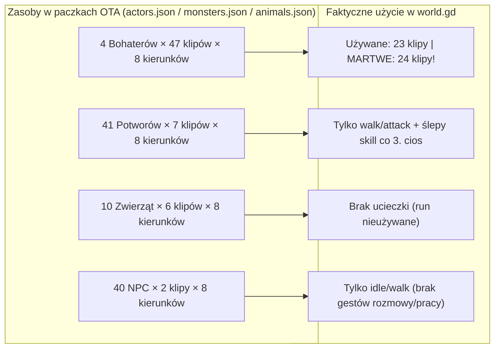

# 2026-11-26 — Kompletny Audyt Kodu, Animacji, Systemów Gry i Architektury MMORPG

Audyt obejmuje całe repozytorium (~38 600 linii kodu na gałęzi `feat/isometric-world-2d-terrain3d-20261118`, wydanie `OTA 1.14.32`):
- **Aktywny świat izometryczny 2.5D (Godot 4.6.3):** [`ports/godot-isometric-world/scripts/`](../../../ports/godot-isometric-world/scripts) (~14 300 linii), shadery, dane `data/*.json` oraz `regions/*`.
- **Powłoka startowa / launcher i wcześniejszy port 2D:** [`ports/godot-pyra/scripts/`](../../../ports/godot-pyra/scripts) (~19 750 linii).
- **Serwer gry i baza danych PostgreSQL:** [`src/server/godot/`](../../../src/server/godot) (~4 520 linii), [`src/server/gameServer.ts`](../../../src/server/gameServer.ts), migracje `deploy/multiplayer/init/*.sql`.
- **Panel Administratora:** [`src/routes/admin.tsx`](../../../src/routes/admin.tsx) oraz `src/components/admin/`.
- **Kanon projektowy właściciela:** [`INDEX.md`](../../INDEX.md), [`ROZWOJ-I-WALKA.md`](../../ROZWOJ-I-WALKA.md), [`SWIAT-I-MIASTA.md`](../../SWIAT-I-MIASTA.md), [`RASY-I-POSTACIE.md`](../../RASY-I-POSTACIE.md), [`FABULA-I-EKWIPUNEK.md`](../../FABULA-I-EKWIPUNEK.md), [`ZASADY.md`](../../ZASADY.md).

---

## 0. Najważniejsze odkrycie architektoniczne audytu

W repozytorium współistnieją obecnie **dwa osobne światy Godot**: starszy płaski port 2D (`ports/godot-pyra/scripts/`) oraz nowy świat izometryczny 2.5D (`ports/godot-isometric-world/scripts/`), uruchamiany w [`service_screen.gd`](../../../ports/godot-pyra/scripts/service_screen.gd). Przy przejściu na nowy silnik izometryczny **ponad 65% gotowych, głębokich systemów RPG i Online pozostało niepodpiętych** w `ports/godot-pyra/scripts/` oraz `src/server/godot/`, w tym:
- działający na serwerze kanał WebSocket obecności innych graczy i czatu ([`live.ts`](../../../src/server/godot/live.ts) + [`online.gd`](../../../ports/godot-pyra/scripts/online.gd)),
- pełne 29-węzłowe mechaniki 4 ras ([`race_kit.gd`](../../../ports/godot-pyra/scripts/race_kit.gd), [`legend_kit.gd`](../../../ports/godot-pyra/scripts/legend_kit.gd), [`planetary_kit.gd`](../../../ports/godot-pyra/scripts/planetary_kit.gd), [`sage_kit.gd`](../../../ports/godot-pyra/scripts/sage_kit.gd), [`android_kit.gd`](../../../ports/godot-pyra/scripts/android_kit.gd)),
- 8 wielofazowych bossów z mechanikami aren ([`boss_script.gd`](../../../ports/godot-pyra/scripts/boss_script.gd)),
- 41 zróżnicowanych zachowań AI potworów i statusów ([`monster.gd`](../../../ports/godot-pyra/scripts/monster.gd)),
- 14 dynamicznych wydarzeń świata ([`world_events.gd`](../../../ports/godot-pyra/scripts/world_events.gd)),
- silnik 102 wieloetapowych zadań ([`quest_engine.gd`](../../../ports/godot-pyra/scripts/quest_engine.gd)).

Nie trzeba pisać tych systemów od zera — można je przenieść i podłączyć bezpośrednio do świata izometrycznego.

---

## 1. Błędy krytyczne i dziury bezpieczeństwa (do naprawy w pierwszej kolejności — Etap 1)

1. **`PANEL GM` widoczny i otwarty dla każdego zwykłego gracza:**
   - W [`rpg_hud.gd`](../../../ports/godot-isometric-world/scripts/rpg_hud.gd) przycisk `PANEL GM` rysuje się bez weryfikacji `KiNet.online().is_staff()`, a w [`world.gd`](../../../ports/godot-isometric-world/scripts/world.gd) skróty `F1`/`P` otwierają [`gm_panel.gd`](../../../ports/godot-isometric-world/scripts/gm_panel.gd).
   - Zwykły gracz może włączyć `8× Speed`, `Noclip` (omijając wymagania poziomowe Labiryntów i Skarbów), ustawić lokalnie `+9999 ATK` i jednym ciosem zabijać Elity Poz. 18, odbierając autorytatywne nagrody z serwera. Z kolei u prawdziwego Admina akcje w `gm_panel.gd` działają tylko lokalnie (nie wysyłają `gm_action`), więc nadpisują się przy następnej synchronizacji z serwerem.
2. **Zepsute leczenie miksturami (`healHp` vs `heal_hp`):**
   - Katalog [`items_catalog.json`](../../../ports/godot-isometric-world/data/items_catalog.json) oraz serwer [`economy.ts`](../../../src/server/godot/economy.ts) definiują pola `healHp` i `healKi` (camelCase), natomiast [`rpg_hud.gd`](../../../ports/godot-isometric-world/scripts/rpg_hud.gd), [`world.gd`](../../../ports/godot-isometric-world/scripts/world.gd) i [`labyrinth_room.gd`](../../../ports/godot-isometric-world/scripts/labyrinth_room.gd) sprawdzają `heal_hp` / `heal_ki` (snake_case).
   - **Skutek:** Kula szybkiej mikstury na HUDzie zawsze pokazuje `0`, klawisz `[H]` zwraca *„Brak eliksirów życia w plecaku!”*, w Labiryncie nie działa leczenie, a po użyciu mikstury w plecaku nie wywołuje się `notify_hero_healed()`, przez co serwer przy `monster_kill` odejmuje stare `hpCost`.
3. **Desynchronizacja fizycznego podnoszenia łupu z ziemi vs natychmiastowego zapisu online:**
   - W trybie online [`world.gd`](../../../ports/godot-isometric-world/scripts/world.gd) wysyła `monster_kill` w chwili śmierci potwora — serwer natychmiast dopisuje złoto i przedmioty do plecaka, zanim ikony spadną na ziemię (`apply_local = false`), więc odejście bez wejścia na drop i tak zachowuje łup. Natomiast zabite zwierzęta (`kind == "animal"`) dodają złoto, PD i miksturę wyłącznie lokalnie, przez co kolejna akcja serwerowa cofa ten postęp.
4. **Brak walidacji anty-cheat akcji PvE po stronie serwera ([`economy.ts`](../../../src/server/godot/economy.ts)):**
   - `monster_kill` ufa poziomowi i fladze `isElite` przysłanym przez klienta (do 14 zabić/s), `claim_treasure` przyjmuje dowolny `itemId` z katalogu (łącznie z bronią legendarną), `inn_rest` / `campfire_rest` / `city_blessing` leczą do 100% bez sprawdzenia miasta ani cooldownu, a `GATHER_GLOBAL_COOLDOWN_MS` jest zdefiniowany, lecz nieegzekwowany.
5. **Rozjazd wzorów Rangi Mistrzostwa i statystyk klient ↔ serwer:**
   - [`rpg_hud.gd`](../../../ports/godot-isometric-world/scripts/rpg_hud.gd) mnoży statystyki procentowo (`1.02×..1.08×` od sumy rang), podczas gdy [`economy.ts`](../../../src/server/godot/economy.ts) dodaje wartości płaskie (`+10..+50 HP`, `+2..+8 ATK`, `+2..+6 DEF`) od minimum ze wszystkich 6 dyscyplin.
6. **Brak zapisu współrzędnych `(x, y)` postaci w bazie danych:**
   - Tabela `godot_android.characters` zapisuje wyłącznie kontynent (`land`), bez pozycji `(x, y)` — po każdym ponownym wejściu do gry bohater ląduje z powrotem w centrum stolicy.

---

## 2. Audyt animacji, modeli i efektów wizualnych (`actor_view.gd`, `combat_vfx.gd`, `actors.json`)

### 2.1 Bohaterowie — 24 z 47 wyrenderowanych klipów na rasę są nieużywane lub błędnie mapowane
Każda z 4 ras (`pyra.hero`, `verdant.hero`, `aether.hero`, `nexus.hero`) ma w [`actors.json`](../../../ports/godot-isometric-world/data/actors.json) komplet **47 ośmiokierunkowych klipów**, ale:
- **5 dedykowanych animacji skilli drzewka (`sk_A9`, `sk_B4`, `sk_B9`, `sk_C4`, `sk_C9` — łącznie 20 zestawów 8-kierunkowych)** nigdy nie jest wywoływanych, ponieważ pasek skilli ma na sztywno wpisane `["R", "A1", "B1", "C1", "A4", "T"]`.
- **Unik (`dodge` oraz `kidodge`) — 0 użyć:** Brak aktywnego przycisku uniku / zrywu (Dash) w świecie izometrycznym, mimo gotowych arkuszy animacji.
- **Garda / Blok (`guard` oraz `kiguard`) — 0 użyć.**
- **Kanałowanie / Ładowanie Ki (`channel` oraz `kichannel`) — 0 użyć w walce:** Brak przycisku ładowania Ki i skilli kanałowanych.
- **Błąd animacji podczas Formy KI (`[T]`) w [`actor_view.gd`](../../../ports/godot-isometric-world/scripts/actor_view.gd):** Gdy aktywny jest `prefix = "ki"`, `play_action("sk_A1", "skill")` sprawdza nieistniejące `"kisk_A1"`, po czym znajduje bazowe `"sk_A1"` zamiast przełączyć na dedykowane **`kiskill` / `kiskillb` / `kiskillc`**. Podobnie 3. cios combo wychodzi z formy Ki do bazowego `"attack3"`.
- **Brak wizualnego efektu założonej broni / rzadkości ekwipunku na postaci:** Założenie rzadkiego lub legendarnego oręża zmienia tylko statystyki w oknie `[I]`, bez świetlnej smugi broni czy aury zestawu.

### 2.2 Potwory, zwierzęta, NPC i efekty bojowe VFX
- **41 potworów (`idle, walk, attack, skill, hit, death, respawn`):** Każdy gatunek posiada klip `skill`, ale [`world.gd`](../../../ports/godot-isometric-world/scripts/world.gd) odtwarza go mechanicznie co 3. zwykły atak wręcz — bez ostrzegawczego telegrafu na ziemi, pocisku i efektu specjalnego. Po śmierci (`death_hide_t = 0.85`) potwór znika skokowo zamiast płynnie zanikać.
- **10 zwierząt fauny (`idle, walk, run, hit, death, respawn`):** Zwierzęta mają gotowy klip ucieczki **`run`**, lecz po trafieniu spacerują dalej w `walk`.
- **40 NPC (`idle, walk`):** Tylko 2 klipy; wewnątrz budynków ([`interior_room.gd`](../../../ports/godot-isometric-world/scripts/interior_room.gd)) postacie usługowe stoją nieruchomo.
- **Efekty bojowe ([`combat_vfx.gd`](../../../ports/godot-isometric-world/scripts/combat_vfx.gd)):** Dostępne są tylko 4 bazowe efekty (`slash`, `bolt`, `shield_dome`, `ki_burst`). Brakuje ciągłych promieni energii (Beam), kręgów światła Mędrca na ziemi, celowników Androida, smug po uniku (afterimage) oraz czerwonych stref telegrafów AoE potworów i bossów.

---

## 3. Audyt wszystkich systemów rozgrywki względem kanonu Ki Legends

| System | Stan obecny w `godot-isometric-world` | Kanon projektu / gotowy kod w `godot-pyra` i braki |
| --- | --- | --- |
| **Pasek skilli i 29 węzłów drzewka (`[K]`)** | Sztywne 6 slotów `["R", "A1", "B1", "C1", "A4", "T"]` ze wspólnym CD i kosztem Ki dla wszystkich ras; **5 aktywnych skilli/ultów na rasę (`B4, C4, A9, B9, C9`) oraz 42 z 72 pasywów są nieaktywne**; max 1 ranga na węzeł; węzeł `T` ma w JSON `type: "ki-mode"`, a UI sprawdza `"transformation"`. | Przypisywalne sloty aktywnych skilli `1–4` + przycisk **Uniku (`Dodge`)** + **Ładowanie Ki (`Channel`)**; pełne działanie wszystkich 29 węzłów z wieloma rangami (`×0.5` pierwsza ranga, `+10%` kolejne zgodnie z [`ROZWOJ-I-WALKA.md`](../../ROZWOJ-I-WALKA.md)). |
| **4 zasoby i mechaniki rasowe** | Wspólny pasek `hero_res (0–100)` z kosmetyczną etykietą (`Żar / Nurt / Skupienie / Ładunek`); rośnie o `+14` przy machaniu w powietrze i wydaje `-50` na generyczne `+30%` obrażeń. | **Legendy:** `Żar 0–100` (`+4` za trafienie, `+0.1%` obrażeń/pkt, opada poza walką, `100` w Formie Ki, spalany przez `C4`). **Androidy:** `Ładunek 0–100` z ryzykiem **Przegrzania (Overheat 2 s)** i wentylacją `C1/C4`. **Planetarni:** adaptacja terenowa (`las / skała / woda`) + 3. cios `×1.3`. **Mędrcy:** naziemne **Kręgi Światła** + kanałowanie Ki. |
| **Walka i celowanie (Targeting)** | Automatyczny wybór najbliższego celu; pociski hitscan; w Labiryntach pasek skilli jest wyłączony (tylko zwykły atak). | **Target Lock** z górnym paskiem HP i słabościami wybranego celu, fizyczne pociski i promienie Ki, unik z `0.35 s` nietykalności oraz **pełny pasek skilli wewnątrz Labiryntów**. |
| **Bestiariusz (41 potworów), 8 Bossów i 14 Wydarzeń** | Wszystkie 41 potworów ma identyczne AI podejścia wręcz (`aggro < 72 m`, cios co `1.4 s`); pola `range`, `skills`, `traits`, `weak` z [`monsters.json`](../../../ports/godot-isometric-world/data/monsters.json) są ignorowane; **0 z 8 Bossów**, **0 z 14 Wydarzeń Świata**, max poziom potwora 18. | Strzelcy/wieżyczki, zasadzki z podziemia, spowolnienia/podpalenia/trucizny/ogłuszenia, słabości żywiołów (`fire/electric/ki/water`), **8 wielofazowych Bossów**, **14 Wydarzeń Świata** oraz warianty endgame **Poz. 22–40**. |
| **Przedmioty, drop i Kuźnia** | **65 przedmiotów** w `items_catalog.json` (do Poz. 15); online `monster_kill` losuje tylko 3 generyczne trofea na kontynent i co 50. zabójstwo daje przedmiot startowy Poz. 1; brak ulepszania `+1..+9` i zestawów. | Pełny katalog **366 przedmiotów i 265 receptur** z [`FABULA-I-EKWIPUNEK.md`](../../FABULA-I-EKWIPUNEK.md), gatunkowe tabele łupów, ulepszanie oręża `+1..+9` u Kowala, bonusy zestawów oraz 6-stopniowa **Broń Dziedzictwa**. |
| **Fabuła, zadania i Dojo** | Zadania u NPC z `!` kończą się **jednym kliknięciem w 1 sekundę** (`+45 PD, +80 zł`) bez wykonywania celów; Rozdziały Dziedzictwa w [`goals.ts`](../../../src/server/godot/goals.ts) zaliczają się automatycznie od samego poziomu. | Wieloetapowe zadania z licznikami celów (zabicia, zwiad, dostawy, bossowie labiryntów), **Tracker Zadań** pod minimapą oraz grywalne **Próby Mistrzów w Dojo** (102 zadania z `quest_engine.gd`). |
| **Świat, 6 Wysp i krzywa PD** | **6 Wysp Archipelagu (`island-1..6`)** widocznych na Globusie 3D i Atlasie 2D nie ma jeszcze regionów w izometrii; krzywa PD wymaga aż **>1,5 mln PD do Poz. 20** (w kanonie `12 160 PD`). | Podróż morska z portów na **6 Wysp Kampanii**, bezpieczne strefy w mniejszych osadach oraz zbalansowana krzywa PD pod progres solo i drużynowy. |

---

## 4. Czego brakuje pod prawdziwe MMORPG w klimacie Ki Legends?

W bieżącym wydaniu `OTA 1.14.32` świat izometryczny działa w **100% jako izolowana instancja jednoosobowa** z zapisem HTTP REST — gracze nie widzą się na mapie i nie mają czatu, mimo że na serwerze działa już hub WebSocket [`/ws/godot/live`](../../../src/server/godot/live.ts) (przez co `/admin` pokazuje `0` graczy Androida online).

### Brakujące filary MMORPG:
1. **Widoczność innych graczy na żywo (Shared World Presence):** renderowanie do 24+ pobliskich graczy na tym samym kontynencie i we wnętrzach miast z płynną interpolacją izometryczną, nickiem, poziomem, tagiem klanu, animacją skilli i **aktywną Aurą Formy KI**.
2. **Wielokanałowy Czat Mobilny i dymki nad głową:** wysuwany panel czatu z kanałami `[Świat]`, `[Kontynent]`, `[Lokalny]` (z dymkiem nad postacią), `[Drużyna]`, `[Klan]`, `[Szept / PW]` oraz linkowaniem przedmiotów.
3. **Wyczuwanie Ki / Skauter i „Poziom Mocy Ki” (`⚡ KI`):** wyliczany wskaźnik Poziomu Mocy Ki rosnący przy transformacji `[T]`, kliknięcie na innego gracza z oknem **„Zbadaj Wojownika”** (podgląd sylwetki Paperdoll i ekwipunku) oraz impuls wykrywający elity i anomalie *Ciszy*.
4. **Drużyny (Party 2–4 graczy) i synergie międzyrasowe:** zaproszenia do drużyny, boczne paski HP/KI sojuszników, wspólny bonus PD, wspólne wejścia do Labiryntów oraz synergie klasowe (Kręgi Światła Mędrca wzmacniające drużynę, Namierzanie Androida zwiększające kryt całej grupy).
5. **Wspólne potwory serwerowe i World Bossowie:** synchronizacja żywych potworów/elit w sektorze kontynentu oraz cykliczni **World Bossowie** z globalnym powiadomieniem, rankingiem zadanych obrażeń i gwarantowanym łupem dla uczestników.
6. **Gildie / Klany (Zakony Ki) i rywalizacja 4 kontynentów:** tabele `guilds` i `guild_members`, czat i skarbiec klanu, `<Tag>` pod imieniem oraz cotygodniowa walka o obeliski Ki między Pyrą, Verdantią, Aetherią i Nexusem-9.
7. **Handel 1-na-1 (P2P Trade) i Dom Aukcyjny (Targowisko):** unikalne `instance_id` przedmiotów w PostgreSQL (ochrona *anti-dupe*), bezpieczne okno wymiany z podwójną akceptacją oraz tablica ofert u Skarbnika/Kupca, plus wspólny **Bank Konta** (między postaciami gracza).
8. **Pojedynki 1v1 na Arenie (PvP Duel):** możliwość wyzwania innego gracza na honorowy sparing 1v1 na Arenie bez utraty PD, z rankingiem zwycięstw.
9. **Rankingi (Top 100), Znajomi i Poczta:** rankingi Poziomu, Mocy Ki, Łowców Bossów i Klanów, lista znajomych online oraz skrzynka pocztowa na utarg z aukcji i nagrody systemowe.
10. **Narzędzia Live-Ops w `/admin`:** ogłoszenia systemowe na żywo na ekranach graczy, wyciszanie czatu (`mute`), bany czasowe, podgląd graczy Androida online na mapie Superiora, mnożniki eventowe `2× EXP / 2× DROP` oraz alerty anty-cheat.

---

## 5. Etapowy plan wdrożenia zmian

1. **Etap 1 — Hotfix bezpieczeństwa, mikstur i spójności zapisu:**
   - Ukrycie `PANEL GM` dla zwykłych graczy (`is_staff()`) i podpięcie akcji GM pod serwerowe `gm_action`.
   - Naprawa leczenia miksturami (`healHp` / `healKi`) na HUDzie, pod `[H]`, w plecaku i w Labiryntach.
   - Serwerowe podnoszenie łupu dopiero po wejściu na drop (`pickup_loot`), synchronizacja polowania na zwierzęta, zapis współrzędnych `(x, y)` postaci oraz uszczelnienie walidacji w `economy.ts` i wzoru Rangi Mistrzostwa.
2. **Etap 2 — Prawdziwy Multiplayer na żywo + Czat + Wizytówki Mocy Ki:**
   - Podpięcie świata izometrycznego do rozszerzonego WebSocketu `/ws/godot/live` (widoczność innych graczy na żywo z animacjami i Aurą KI, poprawny licznik online w `/admin`).
   - Mobilny Czat wielokanałowy z dymkami nad postaciami + wizytówka gracza z podglądem Paperdoll i **Poziomem Mocy Ki**.
3. **Etap 3 — Pełna walka Ki Legends, wszystkie 29 węzłów, Unik i komplet 47 animacji:**
   - Odblokowanie przypisywalnych skilli `A1..C9` na pasku, przycisków **Uniku (`dodge`)** i **Ładowania Ki (`channel`)**, poprawnego `kiskill*` w Formie Ki, pełnych mechanik 4 ras z `*_kit.gd`, wielorangowego drzewka `[K]`, **Target Locka** i paska skilli w Labiryntach.
4. **Etap 4 — Pełny Bestiariusz, 8 Bossów, 14 Wydarzeń Świata, 102 Zadania i 366 Przedmiotów:**
   - Zróżnicowane AI 41 potworów ze statusami i telegrafami AoE, uciekająca w biegu (`run`) fauna, 8 wielofazowych Bossów, 14 Wydarzeń Świata, wieloetapowe zadania z Trackerem na HUDzie, katalog 366 przedmiotów / 265 receptur, ulepszanie `+1..+9` u Kowala i 6 Wysp Archipelagu.
5. **Etap 5 — Systemy społecznościowe i Endgame MMORPG:**
   - Drużyny (Party 2–4), wspólne potwory i World Bossowie serwerowi, Klany/Gildie, Handel 1-na-1 i Dom Aukcyjny, Pojedynki 1v1 na Arenie oraz Rankingi Top 100 i Poczta.
