# 2026-11-26 — Kompletny Audyt Kodu, Animacji, Systemów Gry i Architektury MMORPG

Audyt obejmuje całe repozytorium (~38 600 linii kodu na gałęzi `feat/isometric-world-2d-terrain3d-20261118`, wydanie `OTA 1.14.32`):
- **Aktywny świat izometryczny 2.5D (Godot 4.6.3):** [`ports/godot-isometric-world/scripts/`](../../../ports/godot-isometric-world/scripts) (~14 300 linii), shadery, dane `data/*.json` oraz `regions/*`.
- **Powłoka startowa / launcher i wcześniejszy port 2D:** [`ports/godot-pyra/scripts/`](../../../ports/godot-pyra/scripts) (~19 750 linii).
- **Serwer gry i baza danych PostgreSQL:** [`src/server/godot/`](../../../src/server/godot) (~4 520 linii), [`src/server/gameServer.ts`](../../../src/server/gameServer.ts), migracje `deploy/multiplayer/init/*.sql`.
- **Panel Administratora:** [`src/routes/admin.tsx`](../../../src/routes/admin.tsx) oraz `src/components/admin/`.
- **Kanon projektowy właściciela:** [`INDEX.md`](../../INDEX.md), [`ROZWOJ-I-WALKA.md`](../../ROZWOJ-I-WALKA.md), [`SWIAT-I-MIASTA.md`](../../SWIAT-I-MIASTA.md), [`RASY-I-POSTACIE.md`](../../RASY-I-POSTACIE.md), [`FABULA-I-EKWIPUNEK.md`](../../FABULA-I-EKWIPUNEK.md), [`ZASADY.md`](../../ZASADY.md).

---

## 0. Najważniejsze odkrycie architektoniczne audytu

W repozytorium współistnieją obecnie **dwa osobne światy Godot**: starszy płaski port 2D (`ports/godot-pyra/scripts/`) oraz nowy świat izometryczny 2.5D (`ports/godot-isometric-world/scripts/`), uruchamiany w [`service_screen.gd`](../../../ports/godot-pyra/scripts/service_screen.gd). Przy przejściu na nowy silnik izometryczny **ponad 65% gotowych, głębokich systemów RPG i Online pozostało niepodpiętych** w `ports/godot-pyra/scripts/` oraz `src/server/godot/`, w tym:
- działający na serwerze kanał WebSocket obecności innych graczy i czatu ([`live.ts`](../../../src/server/godot/live.ts) + [`online.gd`](../../../ports/godot-pyra/scripts/online.gd)),
- pełne 29-węzłowe mechaniki 4 ras ([`race_kit.gd`](../../../ports/godot-pyra/scripts/race_kit.gd), [`legend_kit.gd`](../../../ports/godot-pyra/scripts/legend_kit.gd), [`planetary_kit.gd`](../../../ports/godot-pyra/scripts/planetary_kit.gd), [`sage_kit.gd`](../../../ports/godot-pyra/scripts/sage_kit.gd), [`android_kit.gd`](../../../ports/godot-pyra/scripts/android_kit.gd)),
- 8 wielofazowych bossów z mechanikami aren ([`boss_script.gd`](../../../ports/godot-pyra/scripts/boss_script.gd)),
- 41 zróżnicowanych zachowań AI potworów i statusów ([`monster.gd`](../../../ports/godot-pyra/scripts/monster.gd)),
- 14 dynamicznych wydarzeń świata ([`world_events.gd`](../../../ports/godot-pyra/scripts/world_events.gd)),
- silnik 102 wieloetapowych zadań ([`quest_engine.gd`](../../../ports/godot-pyra/scripts/quest_engine.gd)).

Nie trzeba pisać tych systemów od zera — można je przenieść i podłączyć bezpośrednio do świata izometrycznego.

---

## 1. Błędy krytyczne i dziury bezpieczeństwa (do naprawy w pierwszej kolejności — Etap 1)

1. **`PANEL GM` widoczny i otwarty dla każdego zwykłego gracza:**
   - W [`rpg_hud.gd`](../../../ports/godot-isometric-world/scripts/rpg_hud.gd) przycisk `PANEL GM` rysuje się bez weryfikacji `KiNet.online().is_staff()`, a w [`world.gd`](../../../ports/godot-isometric-world/scripts/world.gd) skróty `F1`/`P` otwierają [`gm_panel.gd`](../../../ports/godot-isometric-world/scripts/gm_panel.gd).
   - Zwykły gracz może włączyć `8× Speed`, `Noclip` (omijając wymagania poziomowe Labiryntów i Skarbów), ustawić lokalnie `+9999 ATK` i jednym ciosem zabijać Elity Poz. 18, odbierając autorytatywne nagrody z serwera. Z kolei u prawdziwego Admina akcje w `gm_panel.gd` działają tylko lokalnie (nie wysyłają `gm_action`), więc nadpisują się przy następnej synchronizacji z serwerem.
2. **Zepsute leczenie miksturami (`healHp` vs `heal_hp`):**
   - Katalog [`items_catalog.json`](../../../ports/godot-isometric-world/data/items_catalog.json) oraz serwer [`economy.ts`](../../../src/server/godot/economy.ts) definiują pola `healHp` i `healKi` (camelCase), natomiast [`rpg_hud.gd`](../../../ports/godot-isometric-world/scripts/rpg_hud.gd), [`world.gd`](../../../ports/godot-isometric-world/scripts/world.gd) i [`labyrinth_room.gd`](../../../ports/godot-isometric-world/scripts/labyrinth_room.gd) sprawdzają `heal_hp` / `heal_ki` (snake_case).
   - **Skutek:** Kula szybkiej mikstury na HUDzie zawsze pokazuje `0`, klawisz `[H]` zwraca *„Brak eliksirów życia w plecaku!”*, w Labiryncie nie działa leczenie, a po użyciu mikstury w plecaku nie wywołuje się `notify_hero_healed()`, przez co serwer przy `monster_kill` odejmuje stare `hpCost`.
3. **Desynchronizacja fizycznego podnoszenia łupu z ziemi vs natychmiastowego zapisu online:**
   - W trybie online [`world.gd`](../../../ports/godot-isometric-world/scripts/world.gd) wysyła `monster_kill` w chwili śmierci potwora — serwer natychmiast dopisuje złoto i przedmioty do plecaka, zanim ikony spadną na ziemię (`apply_local = false`), więc odejście bez wejścia na drop i tak zachowuje łup. Natomiast zabite zwierzęta (`kind == "animal"`) dodają złoto, PD i miksturę wyłącznie lokalnie, przez co kolejna akcja serwerowa cofa ten postęp.
4. **Brak walidacji anty-cheat akcji PvE po stronie serwera ([`economy.ts`](../../../src/server/godot/economy.ts)):**
   - `monster_kill` ufa poziomowi i fladze `isElite` przysłanym przez klienta (do 14 zabić/s), `claim_treasure` przyjmuje dowolny `itemId` z katalogu (łącznie z bronią legendarną), `inn_rest` / `campfire_rest` / `city_blessing` leczą do 100% bez sprawdzenia miasta ani cooldownu, a `GATHER_GLOBAL_COOLDOWN_MS` jest zdefiniowany, lecz nieegzekwowany.
5. **Rozjazd wzorów Rangi Mistrzostwa i statystyk klient ↔ serwer:**
   - [`rpg_hud.gd`](../../../ports/godot-isometric-world/scripts/rpg_hud.gd) mnoży statystyki procentowo (`1.02×..1.08×` od sumy rang), podczas gdy [`economy.ts`](../../../src/server/godot/economy.ts) dodaje wartości płaskie (`+10..+50 HP`, `+2..+8 ATK`, `+2..+6 DEF`) od minimum ze wszystkich 6 dyscyplin.
6. **Brak zapisu współrzędnych `(x, y)` postaci w bazie danych:**
   - Tabela `godot_android.characters` zapisuje wyłącznie kontynent (`land`), bez pozycji `(x, y)` — po każdym ponownym wejściu do gry bohater ląduje z powrotem w centrum stolicy.

---

## 2. Audyt animacji, modeli i efektów wizualnych (`actor_view.gd`, `combat_vfx.gd`, `actors.json`)

```mermaid
flowchart LR
    subgraph ZasobyGPU["Zasoby w paczkach OTA (actors.json / monsters.json / animals.json)"]
        H47["4 Bohaterów × 47 klipów × 8 kierunków"]
        M41["41 Potworów × 7 klipów × 8 kierunków"]
        A10["10 Zwierząt × 6 klipów × 8 kierunków"]
        N40["40 NPC × 2 klipy × 8 kierunków"]
    end
    subgraph UzycieRuntime["Faktyczne użycie w world.gd"]
        HU["Używane: 23 klipy | MARTWE: 24 klipy!"]
        MU["Tylko walk/attack + ślepy skill co 3. cios"]
        AU["Brak ucieczki (run nieużywane)"]
        NU["Tylko idle/walk (brak gestów rozmowy/pracy)"]
    end
    H47 --> HU
    M41 --> MU
    A10 --> AU
    N40 --> NU
```



### 2.1 Bohaterowie — 24 z 47 wyrenderowanych klipów na rasę są nieużywane lub błędnie mapowane
Każda z 4 ras (`pyra.hero`, `verdant.hero`, `aether.hero`, `nexus.hero`) ma w [`actors.json`](../../../ports/godot-isometric-world/data/actors.json) komplet **47 ośmiokierunkowych klipów**, ale:
- **5 dedykowanych animacji skilli drzewka (`sk_A9`, `sk_B4`, `sk_B9`, `sk_C4`, `sk_C9` — łącznie 20 zestawów 8-kierunkowych)** nigdy nie jest wywoływanych, ponieważ pasek skilli ma na sztywno wpisane `["R", "A1", "B1", "C1", "A4", "T"]`.
- **Unik (`dodge` oraz `kidodge`) — 0 użyć:** Brak aktywnego przycisku uniku / zrywu (Dash) w świecie izometrycznym, mimo gotowych arkuszy animacji.
- **Garda / Blok (`guard` oraz `kiguard`) — 0 użyć.**
- **Kanałowanie / Ładowanie Ki (`channel` oraz `kichannel`) — 0 użyć w walce:** Brak przycisku ładowania Ki i skilli kanałowanych.
- **Błąd animacji podczas Formy KI (`[T]`) w [`actor_view.gd`](../../../ports/godot-isometric-world/scripts/actor_view.gd):** Gdy aktywny jest `prefix = "ki"`, `play_action("sk_A1", "skill")` sprawdza nieistniejące `"kisk_A1"`, po czym znajduje bazowe `"sk_A1"` zamiast przełączyć na dedykowane **`kiskill` / `kiskillb` / `kiskillc`**. Podobnie 3. cios combo wychodzi z formy Ki do bazowego `"attack3"`.
- **Brak wizualnego efektu założonej broni / rzadkości ekwipunku na postaci:** Założenie rzadkiego lub legendarnego oręża zmienia tylko statystyki w oknie `[I]`, bez świetlnej smugi broni czy aury zestawu.

### 2.2 Potwory, zwierzęta, NPC i efekty bojowe VFX
- **41 potworów (`idle, walk, attack, skill, hit, death, respawn`):** Każdy gatunek posiada klip `skill`, ale [`world.gd`](../../../ports/godot-isometric-world/scripts/world.gd) odtwarza go mechanicznie co 3. zwykły atak wręcz — bez ostrzegawczego telegrafu na ziemi, pocisku i efektu specjalnego. Po śmierci (`death_hide_t = 0.85`) potwór znika skokowo zamiast płynnie zanikać.
- **10 zwierząt fauny (`idle, walk, run, hit, death, respawn`):** Zwierzęta mają gotowy klip ucieczki **`run`**, lecz po trafieniu spacerują dalej w `walk`.
- **40 NPC (`idle, walk`):** Tylko 2 klipy; wewnątrz budynków ([`interior_room.gd`](../../../ports/godot-isometric-world/scripts/interior_room.gd)) postacie usługowe stoją nieruchomo.
- **Efekty bojowe ([`combat_vfx.gd`](../../../ports/godot-isometric-world/scripts/combat_vfx.gd)):** Dostępne są tylko 4 bazowe efekty (`slash`, `bolt`, `shield_dome`, `ki_burst`). Brakuje ciągłych promieni energii (Beam), kręgów światła Mędrca na ziemi, celowników Androida, smug po uniku (afterimage) oraz czerwonych stref telegrafów AoE potworów i bossów.

---

## 3. Audyt wszystkich systemów rozgrywki względem kanonu Ki Legends

| System | Stan obecny w `godot-isometric-world` | Kanon projektu / gotowy kod w `godot-pyra` i braki |
| --- | --- | --- |
| **Pasek skilli i 29 węzłów drzewka (`[K]`)** | Sztywne 6 slotów `["R", "A1", "B1", "C1", "A4", "T"]` ze wspólnym CD i kosztem Ki dla wszystkich ras; **5 aktywnych skilli/ultów na rasę (`B4, C4, A9, B9, C9`) oraz 42 z 72 pasywów są nieaktywne**; max 1 ranga na węzeł; węzeł `T` ma w JSON `type: "ki-mode"`, a UI sprawdza `"transformation"`. | Przypisywalne sloty aktywnych skilli `1–4` + przycisk **Uniku (`Dodge`)** + **Ładowanie Ki (`Channel`)**; pełne działanie wszystkich 29 węzłów z wieloma rangami (`×0.5` pierwsza ranga, `+10%` kolejne zgodnie z [`ROZWOJ-I-WALKA.md`](../../ROZWOJ-I-WALKA.md)). |
| **4 zasoby i mechaniki rasowe** | Wspólny pasek `hero_res (0–100)` z kosmetyczną etykietą (`Żar / Nurt / Skupienie / Ładunek`); rośnie o `+14` przy machaniu w powietrze i wydaje `-50` na generyczne `+30%` obrażeń. | **Legendy:** `Żar 0–100` (`+4` za trafienie, `+0.1%` obrażeń/pkt, opada poza walką, `100` w Formie Ki, spalany przez `C4`). **Androidy:** `Ładunek 0–100` z ryzykiem **Przegrzania (Overheat 2 s)** i wentylacją `C1/C4`. **Planetarni:** adaptacja terenowa (`las / skała / woda`) + 3. cios `×1.3`. **Mędrcy:** naziemne **Kręgi Światła** + kanałowanie Ki. |
| **Walka i celowanie (Targeting)** | Automatyczny wybór najbliższego celu; pociski hitscan; w Labiryntach pasek skilli jest wyłączony (tylko zwykły atak). | **Target Lock** z górnym paskiem HP i słabościami wybranego celu, fizyczne pociski i promienie Ki, unik z `0.35 s` nietykalności oraz **pełny pasek skilli wewnątrz Labiryntów**. |
| **Bestiariusz (41 potworów), 8 Bossów i 14 Wydarzeń** | Wszystkie 41 potworów ma identyczne AI podejścia wręcz (`aggro < 72 m`, cios co `1.4 s`); pola `range`, `skills`, `traits`, `weak` z [`monsters.json`](../../../ports/godot-isometric-world/data/monsters.json) są ignorowane; **0 z 8 Bossów**, **0 z 14 Wydarzeń Świata**, max poziom potwora 18. | Strzelcy/wieżyczki, zasadzki z podziemia, spowolnienia/podpalenia/trucizny/ogłuszenia, słabości żywiołów (`fire/electric/ki/water`), **8 wielofazowych Bossów**, **14 Wydarzeń Świata** oraz warianty endgame **Poz. 22–40**. |
| **Przedmioty, drop i Kuźnia** | **65 przedmiotów** w `items_catalog.json` (do Poz. 15); online `monster_kill` losuje tylko 3 generyczne trofea na kontynent i co 50. zabójstwo daje przedmiot startowy Poz. 1; brak ulepszania `+1..+9` i zestawów. | Pełny katalog **366 przedmiotów i 265 receptur** z [`FABULA-I-EKWIPUNEK.md`](../../FABULA-I-EKWIPUNEK.md), gatunkowe tabele łupów, ulepszanie oręża `+1..+9` u Kowala, bonusy zestawów oraz 6-stopniowa **Broń Dziedzictwa**. |
| **Fabuła, zadania i Dojo** | Zadania u NPC z `!` kończą się **jednym kliknięciem w 1 sekundę** (`+45 PD, +80 zł`) bez wykonywania celów; Rozdziały Dziedzictwa w [`goals.ts`](../../../src/server/godot/goals.ts) zaliczają się automatycznie od samego poziomu. | Wieloetapowe zadania z licznikami celów (zabicia, zwiad, dostawy, bossowie labiryntów), **Tracker Zadań** pod minimapą oraz grywalne **Próby Mistrzów w Dojo** (102 zadania z `quest_engine.gd`). |
| **Świat, 6 Wysp i krzywa PD** | **6 Wysp Archipelagu (`island-1..6`)** widocznych na Globusie 3D i Atlasie 2D nie ma jeszcze regionów w izometrii; krzywa PD wymaga aż **>1,5 mln PD do Poz. 20** (w kanonie `12 160 PD`). | Podróż morska z portów na **6 Wysp Kampanii**, bezpieczne strefy w mniejszych osadach oraz zbalansowana krzywa PD pod progres solo i drużynowy. |

---

## 4. Czego brakuje pod prawdziwe MMORPG w klimacie Ki Legends?

W bieżącym wydaniu `OTA 1.14.32` świat izometryczny działa w **100% jako izolowana instancja jednoosobowa** z zapisem HTTP REST — gracze nie widzą się na mapie i nie mają czatu, mimo że na serwerze działa już hub WebSocket [`/ws/godot/live`](../../../src/server/godot/live.ts) (przez co `/admin` pokazuje `0` graczy Androida online).

### Brakujące filary MMORPG:
1. **Widoczność innych graczy na żywo (Shared World Presence):** renderowanie do 24+ pobliskich graczy na tym samym kontynencie i we wnętrzach miast z płynną interpolacją izometryczną, nickiem, poziomem, tagiem klanu, animacją skilli i **aktywną Aurą Formy KI**.
2. **Wielokanałowy Czat Mobilny i dymki nad głową:** wysuwany panel czatu z kanałami `[Świat]`, `[Kontynent]`, `[Lokalny]` (z dymkiem nad postacią), `[Drużyna]`, `[Klan]`, `[Szept / PW]` oraz linkowaniem przedmiotów.
3. **Wyczuwanie Ki / Skauter i „Poziom Mocy Ki” (`⚡ KI`):** wyliczany wskaźnik Poziomu Mocy Ki rosnący przy transformacji `[T]`, kliknięcie na innego gracza z oknem **„Zbadaj Wojownika”** (podgląd sylwetki Paperdoll i ekwipunku) oraz impuls wykrywający elity i anomalie *Ciszy*.
4. **Drużyny (Party 2–4 graczy) i synergie międzyrasowe:** zaproszenia do drużyny, boczne paski HP/KI sojuszników, wspólny bonus PD, wspólne wejścia do Labiryntów oraz synergie klasowe (Kręgi Światła Mędrca wzmacniające drużynę, Namierzanie Androida zwiększające kryt całej grupy).
5. **Wspólne potwory serwerowe i World Bossowie:** synchronizacja żywych potworów/elit w sektorze kontynentu oraz cykliczni **World Bossowie** z globalnym powiadomieniem, rankingiem zadanych obrażeń i gwarantowanym łupem dla uczestników.
6. **Gildie / Klany (Zakony Ki) i rywalizacja 4 kontynentów:** tabele `guilds` i `guild_members`, czat i skarbiec klanu, `<Tag>` pod imieniem oraz cotygodniowa walka o obeliski Ki między Pyrą, Verdantią, Aetherią i Nexusem-9.
7. **Handel 1-na-1 (P2P Trade) i Dom Aukcyjny (Targowisko):** unikalne `instance_id` przedmiotów w PostgreSQL (ochrona *anti-dupe*), bezpieczne okno wymiany z podwójną akceptacją oraz tablica ofert u Skarbnika/Kupca, plus wspólny **Bank Konta** (między postaciami gracza).
8. **Pojedynki 1v1 na Arenie (PvP Duel):** możliwość wyzwania innego gracza na honorowy sparing 1v1 na Arenie bez utraty PD, z rankingiem zwycięstw.
9. **Rankingi (Top 100), Znajomi i Poczta:** rankingi Poziomu, Mocy Ki, Łowców Bossów i Klanów, lista znajomych online oraz skrzynka pocztowa na utarg z aukcji i nagrody systemowe.
10. **Narzędzia Live-Ops w `/admin`:** ogłoszenia systemowe na żywo na ekranach graczy, wyciszanie czatu (`mute`), bany czasowe, podgląd graczy Androida online na mapie Superiora, mnożniki eventowe `2× EXP / 2× DROP` oraz alerty anty-cheat.

---

## 5. Etapowy plan wdrożenia zmian

1. **Etap 1 — Hotfix bezpieczeństwa, mikstur i spójności zapisu:**
   - Ukrycie `PANEL GM` dla zwykłych graczy (`is_staff()`) i podpięcie akcji GM pod serwerowe `gm_action`.
   - Naprawa leczenia miksturami (`healHp` / `healKi`) na HUDzie, pod `[H]`, w plecaku i w Labiryntach.
   - Serwerowe podnoszenie łupu dopiero po wejściu na drop (`pickup_loot`), synchronizacja polowania na zwierzęta, zapis współrzędnych `(x, y)` postaci oraz uszczelnienie walidacji w `economy.ts` i wzoru Rangi Mistrzostwa.
2. **Etap 2 — Prawdziwy Multiplayer na żywo + Czat + Wizytówki Mocy Ki:**
   - Podpięcie świata izometrycznego do rozszerzonego WebSocketu `/ws/godot/live` (widoczność innych graczy na żywo z animacjami i Aurą KI, poprawny licznik online w `/admin`).
   - Mobilny Czat wielokanałowy z dymkami nad postaciami + wizytówka gracza z podglądem Paperdoll i **Poziomem Mocy Ki**.
3. **Etap 3 — Pełna walka Ki Legends, wszystkie 29 węzłów, Unik i komplet 47 animacji:**
   - Odblokowanie przypisywalnych skilli `A1..C9` na pasku, przycisków **Uniku (`dodge`)** i **Ładowania Ki (`channel`)**, poprawnego `kiskill*` w Formie Ki, pełnych mechanik 4 ras z `*_kit.gd`, wielorangowego drzewka `[K]`, **Target Locka** i paska skilli w Labiryntach.
4. **Etap 4 — Pełny Bestiariusz, 8 Bossów, 14 Wydarzeń Świata, 102 Zadania i 366 Przedmiotów:**
   - Zróżnicowane AI 41 potworów ze statusami i telegrafami AoE, uciekająca w biegu (`run`) fauna, 8 wielofazowych Bossów, 14 Wydarzeń Świata, wieloetapowe zadania z Trackerem na HUDzie, katalog 366 przedmiotów / 265 receptur, ulepszanie `+1..+9` u Kowala i 6 Wysp Archipelagu.
5. **Etap 5 — Systemy społecznościowe i Endgame MMORPG:**
   - Drużyny (Party 2–4), wspólne potwory i World Bossowie serwerowi, Klany/Gildie, Handel 1-na-1 i Dom Aukcyjny, Pojedynki 1v1 na Arenie oraz Rankingi Top 100 i Poczta.

## Etap 1 — pierwsze poprawki dla Androida

Punktem odniesienia jest aktywne OTA **1.14.32**, kod `022b4d9a9`. Gałąź
`fix/android-audit-stage1-20261126` zaczyna się od `c77dd3e2b`, który dopisał audyt
i plan do kodu tego wydania.

| Funkcja | Stan w 1.14.32 | Zmiana | Dowód lokalny |
| --- | --- | --- | --- |
| Dostęp GM | HUD, F1/P i teleport atlasu były dostępne bez potwierdzenia roli. | Launcher potwierdza rolę konta przed wejściem i odświeża ją co 30 s w sesji GM. Utrata roli zamyka panel i wyłącza aktywne ułatwienia. | Test Godot obejmuje zwykłego gracza, GM i utratę uprawnień. |
| Zmiany postaci GM | Przedmioty, złoto, poziom i atrybuty zmieniały się lokalnie i mogły zniknąć po synchronizacji. | Panel wysyła `gm_action` dla postaci serwerowej i pokazuje odpowiedź serwera. Zapis obejmuje też punkty, talenty i testowe HP. Szybkość, przenikanie, podgląd KI i reset cooldownów pozostają narzędziami sesji GM. | Vitest sprawdza autoryzację, przejścia stanu i ponowny odczyt. Test Godot sprawdza żądanie i potwierdzenie. |
| Mikstury HP i KI | HUD i Labirynt szukały innych kluczy niż katalog. Użycie mogło zerować naliczone obrażenia przed odpowiedzią serwera. | HUD, [H], plecak i Labirynt czytają katalog `healHp` / `healKi` oraz starsze pola lokalne. Po udanym leczeniu rozliczane są tylko wyleczone obrażenia. Zmiana przedmiotu w slocie przed obsłużeniem żądania kończy się odmową. | Test Godot sprawdza stan przed odpowiedzią, odmowę, ponowienie, zużycie oraz obrażenia zadane w trakcie oczekiwania. Vitest sprawdza właściwą miksturę i ochronę slotu. |

Polecenie testu Godot 4.6.3 z katalogu repozytorium

```sh
godot --headless --path ports/godot-isometric-world -s tests/audit_stage1.gd
```

- 22 z 22 kontroli Godot i sprawdzenie składni launchera po imporcie projektu.
- Vitest Android z lokalnym PostgreSQL 17.12 i migracjami projektu. 21 z 21 testów zaliczonych, w tym odmowa po odebraniu roli GM i zapis zatwierdzonej zmiany.
- Pełne `npm run typecheck` i lint zmienionych plików TypeScript zaliczone.
- Pełne `npm test` w częściowym checkoutcie. 1969 zaliczonych, 147 niezaliczonych,
  44 pominięte. Wśród niepowodzeń są testy zasobów i map, których nie ma w tym checkoutcie.
- Sprawdzenie na fizycznym Androidzie i odbiór w środowisku testowym jeszcze przed wdrożeniem.
  Przy wdrożeniu backend obsługujący nowe operacje i weryfikację slotu trzeba zaktualizować
  przed aktywacją paczki OTA. Dotychczasowy klient zachowuje możliwość użycia starego formatu akcji.

Następne punkty etapu 1 to transakcyjny odbiór łupu przy podniesieniu,
serwerowe rozliczanie polowania, zapis poprawnej pozycji postaci, walidacja
nagród PvE i czasów odnowienia oraz ujednolicenie Rangi Mistrzostwa.
Obecnie odbiór łupu przy śmierci potwora odbywa się w `applyAndroidAction`;
silnik świata wyświetla go na podstawie zmian plecaka i złota.
Przy zmianie warto zachować blokadę rekordu postaci w `executeCharacterAction`
i rozliczać jednorazowy token podniesienia w tej samej transakcji co nagrodę.

### Etap 1, punkt 3 — łup, polowania i pozycja

| Funkcja | Stan w 1.14.32 | Zmiana | Weryfikacja |
| --- | --- | --- | --- |
| Łup | Serwer dopisywał złoto i przedmioty przy śmierci potwora. | Nowy klient dostaje znacznik łupu. Odbiór na mapie lub w labiryncie wymaga podejścia i ważnego tokenu dla tej postaci. Jedna transakcja księguje cały łup. Pełny plecak zachowuje łup do ponownego podejścia przez maksymalnie 120 s. | PostgreSQL potwierdza pojedynczą wypłatę przy dwóch równoległych żądaniach. Godot sprawdza promień, blokadę powtórzenia i labirynt. |
| Polowanie | PD i łup zwierząt były lokalne. | Serwer zapisuje PD i licznik polowań. Złoto i ewentualna mikstura trafiają na ziemię, według dotychczasowych zasad nagrody zwierzęcia. | Vitest potwierdza odrębne liczniki potworów i fauny oraz reguły odbioru. |
| Pozycja | Relog zaczynał się w stolicy aktualnego lądu. | Cofnięcie zdarzeń przez spóźnioną pozycję blokuje numer wersji odcinka podróży. Klient zapisuje ostatni punkt zewnętrzny co 20 s, przy zmianie postaci i przy przejściu aplikacji w tło. Maska terenu i wersja układu ograniczają zapis oraz odtworzenie. Wnętrza wracają do wejścia na powierzchni. | PostgreSQL sprawdza odczyt punktu po ponownym pobraniu postaci. Godot sprawdza odtworzenie, odrzucenie przeszkody i brak wpływu potwierdzenia zapisu na HP. |

Serwer korzysta z identyfikatorów przeciwników, poziomów i masek przejścia wygenerowanych
z właściwych danych Godot poleceniem `python3 scripts/godot/export_android_world_data.py`.
Walka i ruch nadal są symulowane w kliencie. Serwer sprawdza znane źródło łupu, punkt,
zasięg odbioru, odrodzenie źródła, właściciela tokenu i jednorazowość nagrody.
Dotychczasowy protokół `monster_kill` jest obsługiwany dla OTA 1.14.32.
Nowy protokół dotyczy kolejnej paczki klienta i wymaga zgodnego backendu.

Lokalnie zaliczono 36 z 36 kontroli Godot i 25 z 25 testów Androida z PostgreSQL.
Pełne sprawdzenie TypeScript oraz sprawdzenie składni obu projektów Godot zaliczone.
W tym podejściu testy obejmują zachowanie transakcji i sterowników,
a odbiór na fizycznym Androidzie pozostaje do wykonania.

### Etap 1, punkt 4 — reguły ekonomii PvE

- Serwer wyznacza zawartość skrzyń, poziom dostępu do labiryntu i materiał złoża na podstawie
  regionu oraz identyfikatora z danych Godot. Nadal przyjmuje dotychczasowy format klienta 1.14.32.
  Skrzynia pozostaje zamknięta po odrzuconej próbie, a odrzucone zbieranie nie wygasza zasobu w UI.
- Wspólny czas odnowienia 8 s obejmuje gospodę i ognisko, także przez 8 s po zapisanym zabójstwie.
  Godot sprawdza również własny czas od ostatniej walki. Zbieranie ma 90 s na złoże i 1,2 s
  między zbiorami. Nowy klient podaje pozycję, którą serwer sprawdza względem miejsca interakcji.
- Stary kontrakt rozliczania zabójstw sprawdza kombinację gatunku, lądu, poziomu i elity
  względem mapy. Nowy kontrakt korzysta z identyfikatora spawnu, czasu odrodzenia i miejsca łupu.
- Ranga Mistrzostwa w kliencie używa minimum z sześciu dyscyplin oraz tych samych płaskich
  premii HP, ATK i DEF co serwer. Progi to 3, 6, 10 i 15 treningów w każdej dyscyplinie.

Na kodzie etapu zaliczono 53 z 53 kontroli Godot oraz 28 z 28 testów Androida
z PostgreSQL. Sprawdzono też pełną konfigurację TypeScript, lint zmienionych plików,
dokumentację oraz odtwarzalność eksportu świata.

Odbiór fizycznego Androida i aktywacja nowej paczki OTA pozostają otwarte.
Mechanika walki i bieżąca pozycja nadal pochodzą z klienta. Stary kontrakt
`monster_kill` nadal rozlicza łup natychmiast dla klienta 1.14.32.
Po testowym odbiorze i przejściu na nowe OTA można wygasić tę ścieżkę zgodności.

## Etap 2 — obecność graczy, czat i wizytówki w izometrii

Gałąź `feat/android-audit-stage2-20261126` powstała od `a031be824`.
Wszystkie trzy commity etapu 1 są już w historii gałęzi
`fix/android-audit-stage1-20261126`.

| Funkcja | Przed | Zmiana | Weryfikacja |
| --- | --- | --- | --- |
| Obecność | Świat izometryczny działał bez zdalnych postaci. | Autoryzowany klient korzysta z `/ws/godot/live`. Na powierzchni widać do 24 pobliskich graczy w promieniu 620 jednostek. Wysyłane są kierunek, klip animacji, Forma KI, nick i poziom. Ruch jest interpolowany, a klatki animacji są współdzielone przez postacie tej samej rasy. | PostgreSQL i dwa klienty Godot potwierdziły wymianę stanów oraz izolację kontynentu. |
| Czat | Podpięty wyłącznie do starszego portu. | Panel mobilny ma kanały Świat, Kontynent, Lokalny i Szept. Czat lokalny wyświetla dymki, szept dociera do dwóch uczestników, a pole zachowuje tekst oczekujący na potwierdzenie. | Test czterech zalogowanych połączeń sprawdza odbiorców każdego kanału i licznik `/admin/overview`. Godot sprawdza układ przy 320×568, 360×640, 390×844 i 852×393. |
| Wizytówka | Kliknięcie gracza nie było dostępne. | Kliknięcie pobliskiego gracza otwiera portret i aktualnie założony ekwipunek. Widać też poziom, nick, moc KI i przycisk szeptu. | Test dwóch instancji świata Godot sprawdza otwarcie karty z odpowiedzi serwera. Test API sprawdza zakres widocznych danych. |

Socket otrzymuje postać należącą do zalogowanego konta. Zmiana kontynentu jest
potwierdzana w zapisanej postaci. Podgląd serwisowy i postacie lokalne działają
bez tego połączenia. Prywatne wnętrza i labirynty ukrywają gracza na powierzchni.
Klient bez protokołu 2 zachowuje swój dotychczasowy kanał lokalny i osobny
układ współrzędnych. Ruch i animacje z sieci służą do wyświetlania postaci.

Wskaźnik mocy jest orientacyjny. Serwer używa wzoru
`maks. HP + maks. KI + 10 × (ATK + DEF)` i uwzględnia kosmetyczny stan Formy KI
przez dotychczasowe mnożniki `1,25 ATK` i `1,15 DEF`.
Wskaźnik nie przyznaje nagród i nie zmienia statystyk.

Weryfikacja lokalna obejmuje 30 z 30 testów Androida z PostgreSQL, w tym
22 z 22 kontroli Godot etapu 2 z dwoma połączeniami WebSocket, oraz regresję
53 z 53 kontroli etapu 1. Test natywnego klienta uruchamia się w suite
`src/test/godot-android.test.ts` przy ustawionych `KI_ACCOUNTS_TEST_DATABASE_URL`
i `KI_GODOT_TEST_BIN`. Pełny TypeScript, lint zmienionych plików, dokumentacja
i sprawdzenie skryptów po przeniesieniu do przestrzeni nazw OTA zaliczone.

Trwała lista znajomych, zaproszenia do drużyn oraz tagi gildii pozostają otwarte.
Fizyczny Android i wydanie OTA również wymagają odbioru.

## Dokończenie etapu 2 — Znajomi, Drużyny, Gildie, Paperdoll Wizytówki i Admin Live-Ops

Kontynuacja prac na gałęzi `feat/android-audit-stage2-20261126` domyka wszystkie
pozostałe punkty etapu 2 (znajomi, drużyny 2–4, gildie z tagami `<TAG>`,
6-kanałowy czat mobilny, panel wizytówki gracza oraz podgląd online i ogłoszenia
w panelu `/admin`):

| Obszar | Zmiana | Weryfikacja |
| --- | --- | --- |
| Baza danych PostgreSQL | Dodano migrację `deploy/multiplayer/init/010-godot-android-social.sql` (`godot_android.friendships`, `godot_android.guilds`, `godot_android.guild_members`, `schema_version = 4`) oraz podpięto ją w `deploy/multiplayer/install.sh` i `.github/workflows/online-server-qa.yml`. | Migracje `001`–`010` zaaplikowane bezbłędnie na izolowanym kontenerze PostgreSQL 17. |
| Backend społeczny i WebSocket | Dodano trwały magazyn `src/server/godot/social.ts` (`GodotSocialStore`) i rozszerzono `src/server/godot/live.ts` o protokół znajomych (`friends_sync`, `friend_request/accept/remove`), drużyny 2–4 osobowe na żywo (`party_invite/respond/leave/kick`, czat `party`, rozgłaszanie HP/KI/kontynentu), trwałe gildie (`guild_sync/create/invite/respond/leave/kick`, czat `guild`, `<TAG>` w `peers` i `inspect`) oraz rozgłaszanie komunikatów systemowych (`system`). | Test integracyjny PostgreSQL + WebSocket (`src/test/godot-android.test.ts`): 31/31 testów (15/15 `godot-android.test.ts` + 16/16 `godot-android-economy.test.ts`). |
| Panel `/admin` Live-Ops | Rozszerzono `GET /admin/overview` o listę `onlinePlayers` (przy zachowaniu dotychczasowego obiektu `online: { count, byLand }`), dodano `POST /admin/broadcast` (audyt `GODOT_ADMIN_BROADCAST`) oraz widok zalogowanych graczy i wysyłkę ogłoszeń na żywo w `src/components/admin/AdminGodotPanel.tsx`. | Test API potwierdza `403` dla zwykłego gracza, `200` dla administratora oraz dostarczenie ramki `system` do wszystkich połączonych klientów. |
| Klient Godot — HUD i UI mobilne | Naprawiono kolizję przycisku `CZAT` z centralnym paskiem PD (przeniesiono na lewo od paska PD w poziomie i nad pasek PD w pionie), dodano 2-liniowy `mini_feed`, pasek przychodzących zaproszeń w luce górnego HUD-u, kompaktowy `party_hud`, 4-zakładkowy panel (`CZAT` / `ZNAJOMI` / `DRUŻYNA` / `GILDIA`) z responsywną siatką i 6 kanałami czatu, klasyczną kartę wizytówki RPG Paperdoll z ikonami ekwipunku i przyciskami akcji, obsługę dotykowego tapnięcia gracza na ekranie Androida (`handle_touch` w `world.gd`), tagi `<TAG>` nad głowami (własna postać i zdalni gracze), lekkie VFX walki zdalnych graczy oraz wskaźnik `MOC KI` w oknie postaci `[I]`. | `audit_stage2.gd`: 36/36 kontroli Godot (27 offline w tym 320×568, 360×640, 390×844, 852×393, 1600×720 + 9 testów dwóch natywnych klientów Godot przez WebSocket); regresja `audit_stage1.gd`: 53/53; relokacja OTA `prepare_service_preview.py` (`1558` plików) + `--check-only` wszystkich 5 skryptów w `res://service_preview/pyra/`; wizualny odbiór zrzutów OpenGL3 `1600×720`. |

Pełny TypeScript (`tsconfig`, `tsconfig.e2e.json`, `tsconfig.tools.json`), ESLint
zmienionych plików oraz `scripts/docs/check_documentation.py` zakończyły się
wynikiem pozytywnym.

### Wdrożenie Etapu 1 + Etapu 2 i OTA `1.14.33` (po akceptacji właściciela)

Po wyraźnej decyzji właściciela z 2026-11-26 scalono Etap 1 + Etap 2 do gałęzi
`feat/isometric-world-2d-terrain3d-20261118` (`905768dc`), zbudowano paczkę
`deliveries/godot-content-1.14.33` (`core-c101-b91d5a92d2a6.pck`, 13.4 MB, 424 pliki,
z zachowaniem wszystkich 8 paczek światów i 29 paczek historycznych) oraz
przeprowadzono pełne wdrożenie produkcyjne:
- `multiplayer-database.yml` (`45865383317`) — kopia zapasowa i migracja `010-godot-android-social.sql` (`success`).
- `aruba-production.yml` (`45866793261`) — pełna bramka jakości i wdrożenie backendu Coolify na Aruba VPS (`success`).
- `godot-content-upload.yml` (`45869870009`) — wgranie, publikacja i aktywacja `OTA 1.14.33` (`success`).

## Etap 3 — pełna walka Ki Legends, wszystkie 29 węzłów, pasek `1–4`, Unik, Ładowanie Ki i 4 mechaniki rasowe

Prace na gałęzi `feat/android-audit-stage3-20261126` (od `905768dc`) domykają cały
Etap 3 planu audytu — bez rozbudowy o zewnętrzne silniki, na zasobach 47 klipów
każdej z 4 ras:

| Obszar | Zmiana | Weryfikacja |
| --- | --- | --- |
| Przypisywalny pasek `1–4` i serwer (`economy.ts`, `rpg_hud.gd`) | Dodano `hotbarSlots` w stanie postaci (`createInitialAndroidCharacter`, `normalizeAndroidState`), akcję serwerową `set_hotbar` (`slot: 0..3`, `nodeId: A1..C9`, walidacja odblokowania i zamiana duplikatów), automatyczne przypisywanie nowo odblokowanego skilla w pierwszy zablokowany slot oraz przyciski `[1] [2] [3] [4]` w inspektorze drzewka `[K]`. Naprawiono podwójne liczenie `dmgMult`/`rangeMult` (baza `0.0` zamiast `1.0`) oraz rozmiar węzła `type: "ki-mode"` (`T`). | `godot-android-economy.test.ts` (17/17), `audit_stage3.gd` (60/60) oraz zrzut OpenGL3 `[K]`. |
| Unik (`UNIK [V/Shift]`), Ładowanie Ki (`KI+ [X]`) i Target Lock (`[N]` / klik) | Dodano kule `UNIK [V]` (`0.35 s` klatek nietykalności + szybki zryw + `dodge`/`kidodge` + afterimage) i `KI+ [X]` (`2.0 s` kanałowania +28% KI przerywanego ruchem + `channel`/`kichannel`) na HUDzie. Dodano blokowanie celu (`Target Lock`) z pulsującym złotym pierścieniem na ziemi, górnym paskiem HP/statusów (`PODPAL.`, `OGŁUSZ.`, `SPOWOL.`, `NAMIERZ.`, `PIECZĘĆ`), automatycznym przesunięciem komunikatu `combat_toast_lbl` poniżej paska celu oraz przyciskiem `[×]`. | `audit_stage3.gd` potwierdza `0` obrażeń podczas i-frames Uniku, przyrost KI w trakcie kanałowania oraz celowanie i zrzut OpenGL3 `1600×720` bez kolizji HUD. |
| 4 autentyczne mechaniki rasowe i 10 skilli na rasę (`world.gd`) | **Legendy:** `Żar 0–100` (`+4/+6` tylko na realnym trafieniu, spadek OOC, `100` w Formie KI, `C4` spalające cały Żar, `B4` Gniew, `B9` Ostatni Płomień ratujący przed śmiercią z 30% HP, `A2/C3` podpalenie). **Androidy:** `Ładunek` (`100/150/70`) z **Przegrzaniem** blokującym skille do czasu `C4` Awaryjnego Chłodzenia, `A1` Namierzanie, `C1` Promień Plazmowy, `A8` Multishot, `A9` Egzekucja `<30% HP`, `B9` Fortyfikacja, `C9` Przeciążenie `0 KI`. **Planetarni:** `Adaptacja Terenowa` (`Las +30% KI`, `Skała +10% OBR`, `Woda +8% SZYB`), 3. cios `×1.3`, `A1` Szybki Unik, `B1+B5` podwójny Impuls Ziemi, `C1` HoT, `C9` Odrodzenie. **Mędrcy:** naziemne **Kręgi Światła** (`B2/B4/B9`), `A1` opóźniona `Pieczęć Energii` (bezpieczna po wczesnej śmierci celu), `C1/C4` kanałowanie, `C9` Oświecenie `0 KI`. | `audit_stage3.gd` testuje każdą z 4 ras, w tym `B9` lethal-save, Przegrzanie+`C4`, zmianę terenu `Las↔Skała` oraz wczesną śmierć celu pod Pieczęcią `A1` bez wyjątku. |
| Komplet 47 animacji, Forma KI, 5 nowych VFX i ucieczka fauny | Dodano `KI_CLIP_MAP` w `actor_view.gd`, dzięki czemu `sk_A1..sk_C9`, `attack3`, `finisher` i `guard` w Formie KI zawsze utrzymują klipy `ki*` (`kiskill*`, `kiattack2`, `kifinisher`, `kiguard`). Dodano 5 proceduralnych VFX w `combat_vfx.gd` (`spawn_beam`, `spawn_light_circle`, `spawn_dash_afterimage`, `spawn_target_reticle`, `spawn_channel_ring`), płynne zanikanie alfa po śmierci potworów oraz ucieczkę rannych zwierząt w biegu (`run`). | `audit_stage3.gd` weryfikuje mapowanie na prawdziwym manifeście `pyra.hero` (`actors.json`), wszystkie 5 VFX oraz sprint uciekającej fauny. |
| Pełna walka w Labiryntach (`labyrinth_room.gd`) | Dodano pełny pasek 4 przypisywalnych skilli `[1]–[4]`, `UNIK [V]` i `FORMA KI [R]` (przyciski + klawisze), klatki nietykalności, statusy strażników (`stun_t`, `burn_t`, `slow_t`), pierścienie VFX oraz odliczanie `ki_mode_timer` wewnątrz labiryntu. | `audit_stage3.gd` i zrzut OpenGL3 `1600×720` potwierdzają działanie skilli, uniku i czytelny układ dolnego paska. |

Weryfikacja lokalna Etapu 3: `audit_stage1.gd` (`53/53`), `audit_stage2.gd` (`27/27`),
`audit_stage3.gd` (`60/60`), 38/38 testów Vitest na PostgreSQL 17 z dwoma natywnymi
klientami Godot (`15/15 godot-android.test.ts` + `17/17 godot-android-economy.test.ts`
+ `6/6 service-access.test.ts`), relokacja OTA `prepare_service_preview.py` (`1558`
plików + `--check-only` wszystkich 5 skryptów w `res://service_preview/pyra/`),
pełne sprawdzenie 3 konfiguracji TypeScript, ESLint, `check_documentation.py` oraz
wizualna weryfikacja 3 zrzutów OpenGL3 `1600×720`.

## Etap 4 — pełny bestiariusz 41 potworów, 8 wielofazowych bossów, 14 wydarzeń świata, 102 zadania, 455 przedmiotów, 265 receptur, ulepszanie `+1..+9`, Dojo i 6 Wysp Archipelagu

Prace na gałęzi `feat/android-audit-stage4-20261126` (na bazie Etapu 3 `fa19aa02`)
domykają pełny parytet treści MMORPG z kanonem Ki Legends — bez powiększania 8 paczek
światów `world-*` (wszystkie zmiany mieszczą się w lekkim `core-c101` + backendzie):

| Obszar | Zmiana | Weryfikacja |
| --- | --- | --- |
| Bestiariusz 41 potworów i 8 wielofazowych Bossów (`boss_ai_iso.gd`, `bosses.json`, `combat_vfx.gd`, `actor_view.gd`) | Zróżnicowane AI 41 gatunków (`basic`, `range`, `agro`, `skills`, `traits`, słabości żywiołów z mnożnikiem i tagiem `SŁABOŚĆ!`/`ODPORNOŚĆ`), naziemne telegrafy AoE, strefy zagrożeń, 8 debuffów bohatera (w tym `BLOK LECZ.` blokujący mikstury HP) oraz 8 kanonicznych bossów (2/kontynent: Ygdrasha, Thorgar, Arcykapłan Pustki, Aurelith, Arbiter Zero, Hydra-Rdzeń, Kharzul, Pyrrhax) z fazami, barierami, bezpiecznymi strefami, epickim górnym paskiem HP Bossa i autorytatywnym `boss_defeat`. | `audit_stage4.gd` potwierdza 8/8 bossów, przejścia faz, słabości, `healBlock`; zrzut OpenGL3 `1600×720` potwierdza pasek Bossa, czerwony telegraf i pigułki debuffów. |
| 14 Wydarzeń Świata i 102 wieloetapowe Zadania (`world_events_iso.gd`, `quest_engine_iso.gd`, `quests.json`, `dialogue_strip.gd`, `quest_journal.gd`, `rpg_hud.gd`) | 14 dynamicznych spotkań na drogach z obeliskami/najeźdźcami i `complete_world_event`; 102 grywalne zadania kanoniczne z mapowaniem 28 zleceniodawców na NPC izometrii, reputacją 4 kontynentów, synchronizacją `quest_accept`/`quest_sync_progress`, 4. zakładką `📜 PRZYGODY` w Dzienniku oraz zwijanym Trackerem Zadań i banerem aktywnego zdarzenia pod minimapą. | `audit_stage4.gd` (102/102 zadania, 14/14 zdarzeń), `godot-android-economy.test.ts` (19/19), zrzut OpenGL3 HUD. |
| Katalog v3 (`455` przedmiotów, `265` receptur, `15` zestawów V2, `24` Bronie Dziedzictwa), Kuźnia 3-zakładkowa, `+1..+9` i Próby Dojo (`catalogBridge.ts`, `economy.ts`, `interior_room.gd`, `gm_panel.gd`) | Zespolono katalog v3 (`export_android_catalog.ts`, 100% ikon zweryfikowanych). Kuźnia ma 3 zakładki: `⚒ CRAFTING (265)` z filtrami kategorii (`craft_recipe`), `✦ ULEPSZ (+1..+9)` (`+8%` statystyk/poziom + aura broni `+3/+6/+9` na `actor_view.gd`, `enhance_equip`) i `★ DZIEDZICTWO (I–VI)` (`forge_heritage_weapon`). Na Arenie i w Sali dodano 3 grywalne Próby Mistrza Dojo (`dojo_dodge`, `dojo_skill`, `dojo_ki` → ranga `Mistrz Dojo`, `complete_dojo_trial`). Zbalansowano krzywą PD (`180` na Poz. 1→2, płynne skalowanie do Poz. 40). | `godot-android-economy.test.ts` (19/19), `audit_stage4.gd`, zrzut OpenGL3 3-zakładkowej Kuźni `+6`. |
| 6 grywalnych Wysp Archipelagu (`island-1..6`) i migracja `011` (`islands.json`, `011-godot-android-islands.sql`, `world.gd`, `atlas_overlay.gd`, `globe_view.gd`, `map_3d.gd`, `AdminGodotPanel.tsx`) | Dodano migrację `011-godot-android-islands.sql` (`schema_version = 5`, rozszerzenie `CHECK` dla `land` o `island-1..6`), deterministyczny generator proceduralnych wysp `512 m` współdzielony z serwerem (`export_android_world_data.py`), przystań powrotną `⛵ WRÓĆ NA KONTYNENT (ZA DARMO)`, pierwszy rejs za darmo i kolejne za `10/20/30 zł` oraz 6 klikalnych wysp na Atlasie 2D i Globusie 3D. | PG17 `godot-android.test.ts` (16/16 z testem rejsu i zapisu `island-1` w bazie), `audit_stage4.gd` (6/6 wysp grywalnych), zrzuty OpenGL3 wyspy `island-1` i Atlasu 2D. |

Weryfikacja lokalna Etapu 4: `audit_stage1.gd` (`53/53`), `audit_stage2.gd` (`27/27`),
`audit_stage3.gd` (`60/60`), `audit_stage4.gd` (`95/95`), 41/41 testów Vitest na
PostgreSQL 17 z migracjami `001`–`011` i dwoma natywnymi klientami Godot (`16/16
godot-android.test.ts` + `19/19 godot-android-economy.test.ts` + `6/6
service-access.test.ts`), relokacja OTA `prepare_service_preview.py` (`1564` plików
+ `--check-only` wszystkich 15 zmodyfikowanych i nowych skryptów w
`res://service_preview/pyra/`), pełne sprawdzenie 3 konfiguracji TypeScript, ESLint,
`check_documentation.py` oraz wizualna weryfikacja 5 zrzutów OpenGL3 `1600×720`.


